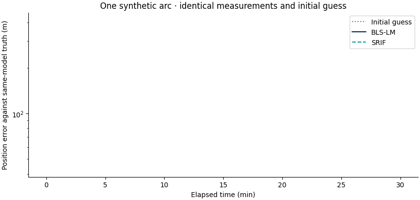

# Lunar Orbit Determination

[](https://github.com/halici21/lunar-orbit-determination/actions/workflows/public-checks.yml)
[](https://halici21.github.io/lunar-orbit-determination/)
[](LICENSE)

**[Quickstart](docs/tutorials/quickstart.md) · [Results](docs/research/results-gallery.md) · [Documentation](https://halici21.github.io/lunar-orbit-determination/) · [Download](https://github.com/halici21/lunar-orbit-determination/releases)**

Reproduce lunar orbit determination experiments and inspect recorded tracking
results through a Python library and native Windows desktop workspace.

The Python library includes lunar and third-body dynamics, state-transition and
SRP sensitivity propagation, station visibility, range/angles/range-rate and
qualified two-way observables, BLS-LM, SRIF, and SR-UKF. Optional gravity and
measurement extensions have individual qualification limits.


[Watch the 60-second desktop walkthrough](docs/media/desktop/desktop-walkthrough.mp4)
or [run the data-free desktop tutorial](docs/tutorials/desktop.md).

| Build experiments | Fit orbital states | Inspect the evidence |
|---|---|---|
| Dynamics, tracking geometry and seeded observations | BLS-LM, SRIF and SR-UKF within their supported profiles | Residuals, recorded comparisons and traceable study artifacts |



A small, data-free example fits **the same observations** with BLS-LM and SRIF.
The [gallery](docs/research/results-gallery.md) includes residuals, source data and
recorded station visibility. This is a one-seed, same-model demonstration;
scientific qualification is stated separately in the
[support matrix](docs/validation/support-matrix.md).

The [three-estimator comparison](docs/research/paired-benchmark.md) reports
64 paired synthetic trials, error distributions, solver stops, covariance
diagnostics and complete raw inputs under a predeclared design.

## Install

**Windows without a Python installation:** download the named
`windows-x64-portable.zip` asset from [Releases](https://github.com/halici21/lunar-orbit-determination/releases),
extract it completely to a writable directory, and open `LunarOD.cmd`.
See the [desktop guide](docs/tutorials/desktop.md) for the built-in tutorial and
external scientific data setup.

The reference environment is Windows x86_64 and Python 3.13.2. Core package
metadata permits Python 3.10+, but other versions/platforms are not covered by
the desktop reference qualification.

```powershell
py -3.13 -m venv .venv
.\.venv\Scripts\python.exe -m pip install -r requirements/windows.txt
.\.venv\Scripts\python.exe -m pip install -e .
```

For library-only use, install with `python -m pip install -e .` in your virtual
environment; add `-r requirements/dev.txt` for development. The import name is
`lunar_od`. No `PYTHONPATH` override is needed.

Library-only wheel imports, analytic propagation and kernel-independent
regressions are checked on Windows and Linux with Python 3.10–3.13.
This platform matrix is separate from desktop and kernel-backed qualification.

On Windows, `setup_windows.cmd` installs the pinned environment and editable
package; `launch_lunar_od.cmd` starts the desktop app. See the
[Windows guide (Türkçe)](docs/windows-quickstart.md).

## First orbit determination fit

```powershell
python examples/quickstart_od.py
```

No kernels or gravity downloads are required. The example saves CSVs, PNG/SVG
figures, the config, seed, environment and source hashes under `outputs/quickstart/`.
Follow the [tutorial](docs/tutorials/quickstart.md) for expected output and model limits.

For configured scenarios and the desktop:

```powershell
python examples/scenario_config_cli.py --schema
python examples/run_scenario_config.py config.json --dry-run
python desktop_app/main.py
```

The desktop can open without SPICE data. Scientific scenarios require the
[kernel setup](docs/windows-quickstart.md#spice-kernels); historical campaigns
may additionally require external data described in [data/README.md](data/README.md).

## Repository layout

```text
src/lunar_od/           importable scientific library
tests/                  unit, integration, regression and science checks
examples/               runnable examples and retained compatibility drivers
studies/phase17/        scripts, configs, reports, results and provenance
docs/                   theory, validation, research and development guidance
desktop_app/            native application (separate from the library)
tools/                  setup, verification and maintenance utilities
fixtures/               small committed reference inputs
data/                   external-data policy (large data are not bundled)
archive/                immutable historical preservation material
requirements/          optional, development, docs and pinned Windows profiles
legacy/                earlier Tkinter and HTTP interfaces
```

See the [architecture and artifact policy](docs/development/repository-layout.md)
and [Phase 17 guide](studies/phase17/README.md) for reproduction and historical
path resolution. Local generated runs go to ignored `results/` or `outputs/`.

The root `requirements.txt` remains the standard core dependency file.
See [dependency profiles](requirements/README.md) and
[earlier interface commands](legacy/README.md) for the grouped optional tools.

The station catalogue adapts its actions and map to narrow windows; see the
[layout guide](docs/development/station-layout_2026-10-15.md).

## Validation

```powershell
python -m pip check
python tools/check_repository.py
python tools/run_public_checks.py --junitxml outputs/public-checks.xml
python -m pytest -p tests.desktop_preferences -ra
```

The public CI gate uses committed fixtures and isolates external campaign data.
The full suite includes scientific qualification checks; unavailable external
inputs produce the suite's existing skips. Long campaigns are manual. See
[verification scope](docs/validation/verification.md),
[test categories](tests/README.md), and the
[migration verification record](docs/development/repository-professionalization.md).

## Research status and limitations

Results are primarily synthetic validation and model self-consistency studies.
Passing tests, UI checks, or process completion do not establish operational
navigation accuracy or estimator convergence. This project has no claim of
flight qualification or real-mission validation. External tool comparisons
qualify only their documented assumptions.

The production planetary ephemeris is **DE440** since roadmap phase C4-I; results
recorded earlier used DE421, which remains selectable with
`LUNAR_OD_PLANETARY_EPHEMERIS=DE421` and reproduces them bit for bit. The measurement
and dynamics upgrades of phases C1–D2 and the first real LRO tracking studies (F1–F2)
are summarised in the [changelog](docs/changelog.md); each phase has a predeclared
report under `studies/phase17/reports/phase_*.md`.

For current scientific conclusions, superseded results and known defects, start
with the [authoritative Phase 17 status](studies/phase17/reports/phase17_authoritative_status.md)
and [defect ledger](studies/phase17/reports/phase17_harden_defect_ledger.md).
The [baseline research guide](docs/research/research-guide.md) explains the
models and earlier experiment families.

## Citation and license

Use [CITATION.cff](CITATION.cff) and record the exact Git commit, study
configuration, inputs and seeds used. No DOI is currently declared.
Copyright and reuse terms are in the [MIT license](LICENSE). Third-party data
and dependencies retain their own terms.

See the [roadmap](docs/roadmap.md), [contribution guide](.github/CONTRIBUTING.md) and
[release procedure](docs/development/releases.md) for the next research and
delivery milestones.
