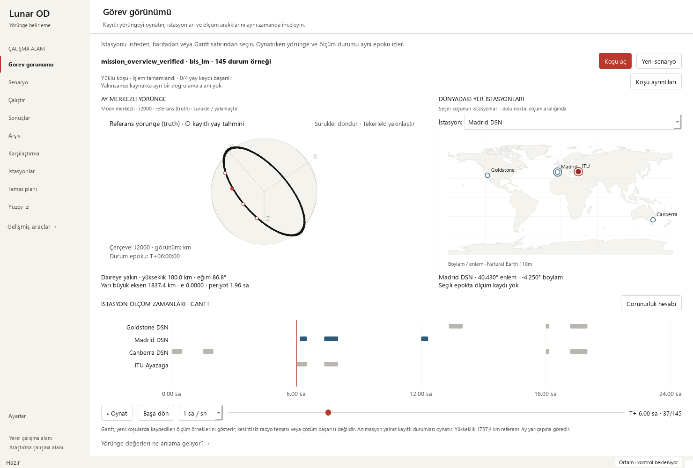

# Lunar OD

Lunar orbit determination research framework with a native Windows desktop
workspace. Configure scenarios, run BLS-LM / SRIF / SR-UKF experiments, inspect
recorded results, and compare runs with their saved settings and source metadata.

[MIT license](LICENSE) · [Releases](https://github.com/halici21/lunar-orbit-determination/releases) · [Documentation](docs/README.md)

## Start on Windows

1. Install **64-bit Python 3.13** from [python.org](https://www.python.org/downloads/windows/).
2. Download a source ZIP from [Releases](https://github.com/halici21/lunar-orbit-determination/releases), or clone this repository. Extract the ZIP before running anything.
3. Double-click **setup_windows.cmd** to install the pinned environment in this folder.
4. Double-click **launch_lunar_od.cmd** to open the desktop app.

The launcher runs setup on first use if no environment exists. Setup requires
internet access. This distribution uses Python; a standalone EXE installer is
not provided.

**Türkçe:** [Windows kurulum ve kullanım rehberi](docs/windows-quickstart.md).

Or from PowerShell in the repository root:

    py -3.13 -m venv .venv
    .\.venv\Scripts\python.exe -m pip install -r requirements-validated-windows.txt
    .\.venv\Scripts\python.exe desktop_app/main.py

The UI can open without SPICE data. Scientific runs require the
[SPICE kernels](docs/windows-quickstart.md#spice-kernels); kernels and historical
campaign data are not bundled. The validated environment is Windows x86_64,
Python 3.13.2; other platforms are not covered by this desktop release.

## Desktop workflow

| Screen | Use |
| --- | --- |
| Görev görünümü | Play stored orbit samples alongside Earth stations and the recorded measurement Gantt |
| İstasyonlar / Temas planı / Yüzey izi | Inspect the catalogue, compute independent visibility, or explore the lunar surface track |
| Senaryo | Configure a reproducible scenario or derive one from a saved run |
| Çalıştır | Run in a separate process; inspect logs and cancellation status |
| Sonuçlar | Inspect recorded states, errors, metadata and source provenance |
| Arşiv | Find existing runs and reopen their verified artifacts |
| Karşılaştırma | Compare exactly matched records; export and reopen the workspace |
| Ayarlar / Ortam | Check runtime and kernels; save the kernel directory for subsequent jobs |

On main, startup and Scenario Builder preflight report missing dependencies or
kernels before computation; see [readiness checks](docs/environment-readiness_2026-10-10.md).
This feature postdates the v0.1.0-alpha.1 source ZIP.

Modern and Orchid themes are available in Settings. Station, visibility and
surface-track tools are now visible in the main sidebar; other specialist pages
remain expandable. New runs record actual measurement epochs for the mission
Gantt. Legacy runs without those epochs show an explicit missing-data message.
Station selection also works through the keyboard-accessible dropdown and
Gantt row labels. Mission plots stack vertically in narrow windows.
See the [mission guide](docs/mission-overview_2026-10-11.md),
[usability iteration](docs/mission-usability_2026-10-11.md) and the
[desktop workflow and data contracts](desktop_app/RESULT_WORKFLOW.md).
The mission caption also exposes process completion and recorded arc-success
fields, with a direct result-inspector action; see the
[status iteration](docs/mission-status_2026-10-11.md).
The initial view explains how to begin; loaded runs retain specific missing-data
messages. See [first-run guidance](docs/mission-onboarding_2026-10-12.md).

The current entry point is desktop_app/main.py. The older Tkinter and local web
tools remain for reference; see [legacy tools](docs/legacy-tools.md). There is no
hosted web application for the current desktop workflow.

## What is verified

- **Local combined suite, 2026-10-12:** 1,793 passed checks, 29 skipped, zero failures/errors.
  Final public gate: 265 passed.
- **Public checks:** core geometry/orbit/dynamics/configuration regressions plus
  desktop artifact, process, archive, comparison, rendering and session checks.
  External data paths are isolated; this gate uses committed fixtures only.
- **Real desktop workflow:** short recorded runs, derivation, comparison, export
  and reopening were exercised. Eight existing single-arc runs remained readable.

[Local verification record](docs/mission-onboarding_2026-10-12.md) ·
[Public CI scope](docs/verification.md) ·
[Latest Actions runs](https://github.com/halici21/lunar-orbit-determination/actions)

Passing UI tests or completing a process does not establish estimator convergence.
The deliberately short BLS workflow runs retained operational_success=False.
Long real-run acceptance and optional data-heavy scientific campaigns remain
separate.

Run the public checks in the installed environment:

    .\.venv\Scripts\python.exe tools/run_public_checks.py --junitxml outputs/public-checks.xml

## Repository map

| Path | Contents |
| --- | --- |
| lunar_od/ | Scientific library: propagation, observables, estimation and diagnostics |
| desktop_app/ | Current PyQt5 application and artifact workspace |
| examples/ | Scenario runners and research/qualification scripts |
| tests/, fixtures/ | Regressions and committed reference fixtures |
| docs/ | User guides, scientific contracts and qualification reports |
| artifacts/, 08_manifests/ | Committed scientific evidence and provenance |
| archive/ | Preserved historical work; not active implementation |
| tools/ | Public checks and Windows setup helpers |
| results/ | Local generated runs; created as needed and ignored by Git |

## Research and development

The framework supports Moon-centered propagation, station visibility, synthetic
tracking, and batch/sequential estimation. Baseline and optional models have
different fidelity and qualification limits; see the
[research guide](docs/research-guide.md) and
[authoritative scientific status](docs/phase17_authoritative_status.md).

Use **main** for current development. Previous branch tips are preserved under
branch-history/2026-10-10/ tags. Historical snapshots do not replace current code.
[Contributing](CONTRIBUTING.md) · [Changelog](CHANGELOG.md) ·
[Branch consolidation audit](docs/branch_consolidation_2026-10-10/README.md)

## License and citation

[MIT License](LICENSE), copyright 2026 Cemil Eray Halıcı.

For academic use, cite the related Lunar Orbit Determination graduation project
and the commit/tag used to produce your results. A stable DOI or formal release
citation is not registered in this repository.
