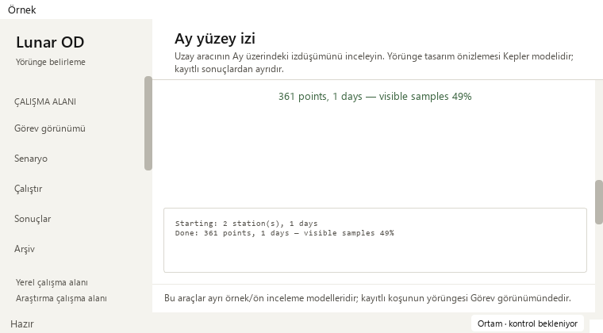
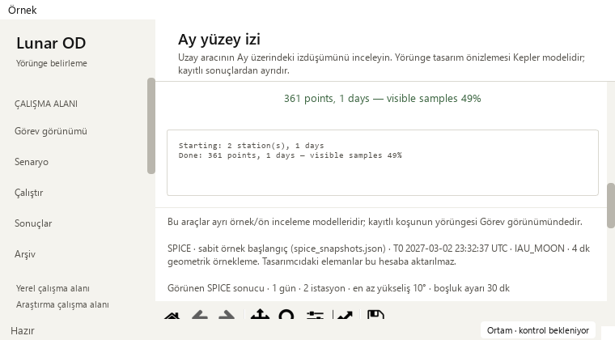

# Compact ground-track controls — 2026-10-20

Base: `b5394646d55a29c9ab3b3337925238c8cf2a7168` (PR #35).
Changed area: the stacked control panel's maximum height in `_adapt_layout`.

## Reproduced usability issue

The narrow panel's expanding spacer consumed useful space between request status
and its log. The actual prior 361-sample SPICE example showed a **132 px** gap
when ready/failed and **148 px** while pending at 910 × 465 and 760 × 420.
This pushed the source/model captions farther down despite all controls fitting.
All six new ready/pending/failed regression cases failed the compactness target
on the base. The separate initial four-sample UI probe recorded 140–158 px gaps.

The paired screenshots align the request status at the same scroll position.
They use the same prior example, not a new propagation or spacecraft telemetry.





## Small change and preserved workflow

In a page content width below 900 px, cap the panel at its computed minimum/
wrapped-content height. On returning to the wide arrangement, release the cap.
The change adds **one `setMaximumHeight` call** and its explanatory comment.

- Keep the intentional margins, spacing, station-list scroll, parameters,
  compute/playback/reset/export actions, progress indication and fixed-height log.
- Ready and failed gaps are now **30 px**; pending is **46 px**, including its
  existing progress bar and spacing. The explicit regression target is at most
  48 px; no numerical/scientific tolerance is involved.
- Long status/recovery text still expands the computed form height. It does not
  get clipped by a fixed arbitrary panel size. All controls/log rectangles fit,
  and the existing outer scroll exposes each control, including disabled ones.
- Freed height goes to the chart. In the paired example, the panel is about
  104–105 px shorter, and the chart receives that space. **Total page height and
  overall scroll distance are unchanged**; this is a control-density improvement.
- Wide panel/chart heights are unchanged. Repeated wide/narrow round trips remain
  stable, and source data, parameters, result/canvas identity and paused index
  stay intact. The independent designer and its visibility-scoped timer retain
  their existing behavior.

## Source, data and artifact boundary

The **entire controller AST matches the base after removing that single new
maximum-height call**. A further 38 normalized source-segment hashes match,
including the full SPICE worker, constants, numerical helpers, static renderer,
result/canvas installation, request handlers, animation, exports and analytical
preview/generation. No physics, frame, epoch, tolerance, sample, visibility rule,
station, export schema, palette or text changes.

Modern and Orchid each check nine before/after state/window pairs: ready,
pending and failed at 1480 × 1000, 910 × 465 and 760 × 420. That is 18 paired
native layouts, including 12 narrow pairs. The baseline restores the exact old
layout method on the otherwise AST-identical controller. Logs/errors use a
controlled pending worker to qualify UI state handling, not a new scientific run.

The old plot's input-array bytes, figure/canvas, source caption and paused
sample survive resizing and a controlled failure. CSV remains byte-identical:
SHA-256 `f9f0f1a605f71bc6cbd3eecad291e1310b69a1316afc8a1c53fd943f7483bb0a`.
Explicit keyboard edit/Generate still creates the separate 0.1-day analytical
preview with 340 samples and visibility uncomputed. PNG appearance/size is not
claimed byte-identical when the chart receives more height.

The existing saved solver output still opens 145 truth states, four stations
and 12 measurement-sample windows, with Madrid selection and linked playback
21600 → 25800 s, including the minimum Mission window.
Its observations remain synthetic, operational success remains 0/4, and
convergence remains unknown in that source. Eight legacy runs retain their
missing-data guidance; all 48 original source-file hashes are unchanged.

## Validation

| Gate | Evidence |
| --- | --- |
| Baseline | All six new state/size cases fail the blank-gap constraint |
| Focused density + responsive tabs | 10 passed; 41.859 s |
| Public, external inputs isolated | 374 passed; no failures/errors/skips; 120.511 s |
| Full local regression | 1,935 passed checks; 29 existing skips; no failures/errors; 557.557 s |
| Native review | Modern/Orchid; wide + two minimum/narrow sizes; ready/pending/failed; long wrapped status; designer edit/Generate |
| Preservation | Whole-file AST delta is one height-bound call; 38 source segments and input/export/source hashes unchanged |

Full JUnit records 1,964 checks: 1818 named cases plus
146 unittest subchecks. Existing skips are 21 opt-in slow checks and eight
unavailable external-data checks. Existing numerical-reference and historical-
reproduction warnings are retained. Durations are validation times, not a
responsiveness or solver-performance benchmark.

```powershell
python -m pytest -p tests.desktop_preferences tests/test_ground_track_density.py tests/test_ground_track_layout.py -q
python tools/run_public_checks.py --junitxml=outputs/public.xml
python -m pytest -p tests.desktop_preferences tests -q -ra --junitxml=outputs/full.xml
python -m pip check
python tools/check_repository.py
git diff --check
```

The [sanitized receipt](ground-track-density-receipt_2026-10-20.json) holds JUnit
hashes, paired geometry, protected sources and existing-record evidence.
Dependency, repository/link and whitespace checks pass. Strict MkDocs is absent
from the local scientific runtime; the existing hosted Documentation gate supplies
it. Required Public, Documentation, Library and Dependencies checks, plus Release
qualification, must pass before a normal protected merge. No dependency,
workflow or long campaign was added.

## Acceptance and next work

**Pass for the reproduced expanding gap in the narrow control panel.**
All controls and source distinctions remain present. Small windows still need
vertical scrolling; no overall page-height or large-record speed improvement
is claimed. Published portable release assets are unchanged.

- Completed: responsive panels, plot palette/caption legibility, compact narrow control/status/log grouping.
- Next: first-use wording and singular/plural units, retaining clear model/source explanations.
- Then: keyboard discoverability and focus/navigation guidance across the independent tools.
