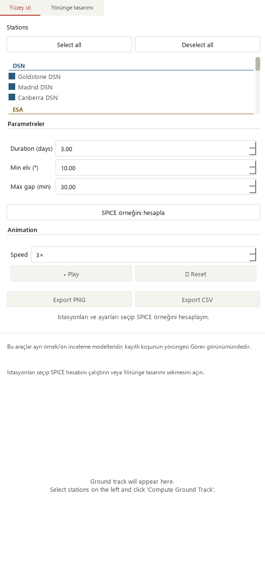
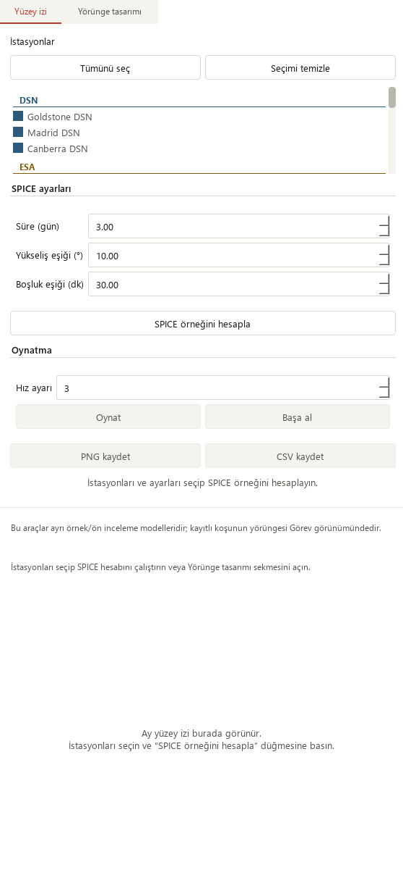
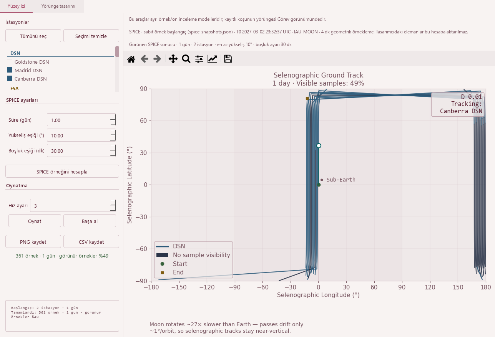

# Ground-track first-use guidance and time labels — 2026-10-20

Base: `4d70c5ffc15ac7856914f82d699fc414629debeb` (PR #36).
Scope: SPICE surface-track controls and their help/status text; plot day grammar.

## Reproduced problems

1. The empty state directed the user to **Compute Ground Track**, while the
   actual action was **SPICE örneğini hesapla**. It also said stations were
   **on the left**, although the small layout puts them above the plot. Mixed
   labels such as **Min elv** and **Max gap** gave little explanation of the
   inputs. The reset glyph rendered as an empty box in the native font.
2. The speed setting displayed **3×**, although the implementation adjusts
   both sample skipping and timer interval, with a minimum timer interval.
   It is not a physical time multiplier. The one-day result also read **1 days**.

The screenshots below capture the actual Qt page at a 760 × 420 window. Full
page captures expose the scrollable content; they do not imply all of it fits
in the viewport. Baseline captures were made before editing production files.





## Changes

- Use Turkish SPICE panel headings, station-selection, playback/reset, save,
  status and controller-generated log text. Spell out **Yükseliş eşiği (°)**
  and **Boşluk eşiği (dk)**, with **Süre (gün)**.
- The wrapped empty state names the real action and works in either layout.
  Existing source/model notes still explain the independent SPICE example,
  analytic preview and saved-run Mission view.
- Add short hover help for duration, local-horizon elevation, SPICE source,
  speed, reset and saves. The existing gap help explicitly retains that raw
  plot/CSV samples are not gap-filled visibility windows.
- Label the same 1–20 playback setting **Hız ayarı**, remove the misleading
  multiplication suffix, and explain its display-only role. Values, limits,
  timer intervals and sample stepping are unchanged.
- Plot titles correctly use **1 day** and **0.1 days**. The English scientific
  plot/legend vocabulary and the analytic designer's existing labels remain.
  This is not a claim of complete application localization. Raw worker
  diagnostics and error details remain available in their original language.



## Preservation and risk

The source receipt checks **31 exact source segments**, including the full
SPICE worker, analytic designer, numerical helpers, constants, CSV/PNG export
methods, result installation, input capture and layout. A separate whole-file
AST comparison matches after masking display strings/formatting, the title
call and eight added tooltip/wrapping calls. This structural check supplements
the reviewed source diff; it is not an independent scientific validation.
The XML structure matches after masking strings and removing only the speed
suffix. No input values, ranges, defaults, scientific code or dependency changed.

Modern and Orchid each verify empty/ready/pending/failed states at 1480 × 1000,
910 × 465 and 760 × 420, before and after: **24 paired native layouts**.
Longer labels fit the 320 px panel; all controls remain reachable with no
horizontal page scrolling. Wrapped model/source text fits. Play, pause and reset
still work after a controlled worker failure, retaining the previous result.

The 361-sample SPICE example is the previously hashed local example replayed
through a controlled worker, not a new propagation or spacecraft telemetry.
Array bytes and exported CSV remain identical, SHA-256
`f9f0f1a605f71bc6cbd3eecad291e1310b69a1316afc8a1c53fd943f7483bb0a`.
Explicit 0.1-day analytic generation still yields 340 samples, no UTC epoch and
uncomputed station visibility. No sampling, coverage or solver-fit improvement
is claimed.

The existing saved solver output still loads 145 truth states, four stations
and 12 measurement-sample windows. Madrid selection and linked playback run
21600 → 25800 s in wide and minimum Mission windows.
Its observations remain synthetic, operational success remains 0/4, and
convergence is unknown in that source. Eight legacy runs preserve missing-data
guidance and all 48 source-file hashes.

## Validation

| Gate | Evidence |
| --- | --- |
| Baseline | Native captures reproduce obsolete action/left-only wording, 3× and 1 days |
| Focused existing ground-track suites | 52 passed; 36.598 s |
| Public isolated-fixture suite | 374 passed, no failures/errors/skips; 108.568 s |
| Full local regression | 1,935 passed checks, 29 existing skips; 527.139 s |
| Native UI review | Modern/Orchid, wide/two narrow sizes, four states, exports and playback |
| Source/data checks | 31 exact segments, display-only AST/XML delta, identical sample arrays/CSV |

Three existing assertions were updated to the new display wording: readable
singular title, Turkish resume action, and explicit zero sampled visibility.
Behavioral and source oracles are retained; no tolerance was loosened. No new
string-map-only test or campaign was added. The final public/full suites and
native captures include the final controller log wording; the focused run
preceded those three log-header translations.

Full JUnit records 1,964 checks: 1,818 named cases plus 146 unittest subchecks.
The 29 existing skips are 21 opt-in slow and eight unavailable external-data
checks. Existing numerical-reference and historical-reproduction warnings
remain visible. Durations are validation times, not performance benchmarks.

```powershell
python -m pytest -p tests.desktop_preferences tests/test_ground_track_models.py tests/test_ground_track_lifecycle.py tests/test_ground_track_legibility.py tests/test_ground_track_workflow.py tests/test_ground_track_results.py tests/test_ground_track_layout.py tests/test_ground_track_density.py -q
python tools/run_public_checks.py --junitxml=outputs/public.xml
python -m pytest -p tests.desktop_preferences tests -q -ra --junitxml=outputs/full.xml
python -m pip check
python tools/check_repository.py
git diff --check
```

See the [sanitized receipt](ground-track-guidance-receipt_2026-10-20.json) for
JUnit hashes, labels and source evidence. Dependency/repository/whitespace checks
pass. Hosted strict Documentation, Public, Library, Dependencies and Release
qualification must pass before normal protected merge; exact merged-main CI is
checked separately in a local hosted receipt. No tooling configuration changed.

## Acceptance and next work

**Pass for misleading first-use instructions and time-setting labels.**
The small window still requires vertical scrolling. Published portable assets
remain unchanged; the source-based local shortcut receives this change on its
next launch. No running user app was restarted.

- Completed: responsive panels, legible plots, compact status/log grouping,
  matching first-use instructions, explanatory SPICE labels and truthful time labels.
- Next: keyboard discoverability and accessible focus/help navigation across
  the independent tools, including the remaining analytic-designer wording.
- Then: review recorded-run selection and large-archive loading only if a
  concrete reproducible problem is found.
