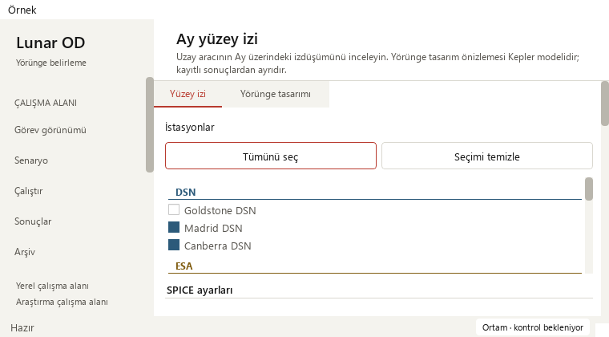
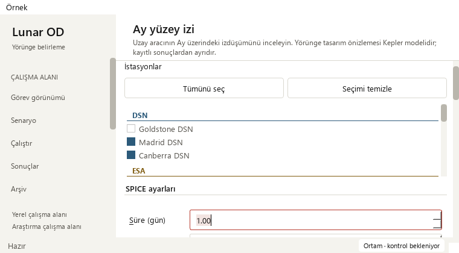
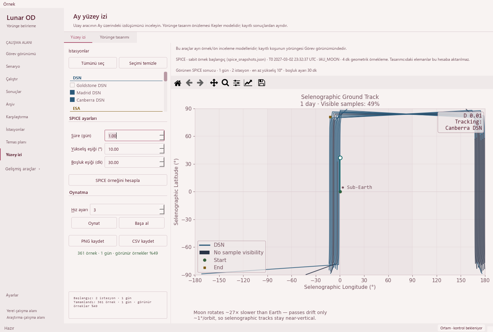

# Keyboard access to SPICE surface-track settings — 2026-10-21

Base: `6d35be159fcd7d3e50e70830baeffadf4a0d240e` (PR #37).
Scope: four SPICE controls' label shortcuts and keyboard focus visibility.

## Reproduction and workflow

The duration, minimum elevation, gap threshold and playback-speed labels had
no mnemonic/buddy association. All eight new field/size cases failed to move
focus using their label keys. Native Modern/Orchid captures confirm the same
at 1480 × 1000, 910 × 465 and 760 × 420.

Adding only native label buddies made the four wide cases pass, but all four
minimum-window cases failed full-field visibility: focus moved below the
viewport. An intermediate check also found that Qt's default focus scrolling
could leave part of the spin box outside the viewport when tabbing between
duration and elevation. These were fixed without relaxing the bounds oracle.





| Key | Target | Unit |
| --- | --- | --- |
| Alt+S | Süre | gün |
| Alt+Y | Yükseliş eşiği | ° |
| Alt+B | Boşluk eşiği | dk |
| Alt+H | Hız ayarı | display setting, not a physical multiplier |

## Implementation

- Use native Qt label mnemonics and buddies, with a short shortcut tooltip
  on each label and an explicit unit-bearing accessible name on each field.
  The existing application Alt+number navigation shortcuts are unchanged.
- Install a focus filter only on those four fields. Keyboard shortcut, Tab
  and backward Tab focus queue a one-shot reveal after Qt's own focus handling.
- Reveal by the full widget's vertical bounds, with 12 px breathing room when
  scrolling is needed. Check the actual focused, visible control when the
  callback runs. Mouse and ordinary programmatic focus do not trigger this helper.
- The nearest ancestor scroll area supplies the viewport; the controller does
  not depend on a MainWindow field or change other pages' focus behavior.
  No continuous timer, worker, animation or scientific task was added.



The entire controller AST matches the base after removing just the QEvent
import, four-field registration
and the two new focus methods. XML structure matches after removing only the
four mnemonics/buddies/shortcut tips/accessible names. Existing numerical
functions, worker, renderer, inputs/defaults/ranges, result installation,
animation timing, provenance and CSV/PNG serializers are unchanged. The local
dependency graph was refreshed without LLM labeling; no tooling config changed.

## Validation

| Gate | Evidence |
| --- | --- |
| Base | All eight shortcut regression cases fail to reach the intended field |
| Buddy-only probe | Four wide pass; four narrow fail full-widget visibility |
| Final focused keyboard/layout/workflow/lifecycle | 29 passed; 31.096 s |
| Public isolated-fixture gate | 382 passed, zero failures/errors/skips; 113.85 s |
| Full local regression | 1,943 passed checks, 29 existing skips; 619.786 s |
| Native Qt | Modern/Orchid, three sizes, four states, before/after |

The eight behavioral cases send real Qt key events and check the intended
field's focus, complete viewport containment, keyboard value changes and
retained data/figure/canvas/index plus identical old-result CSV. They verify
disabled controls during a pending request and no focus interception from
the hidden page. The duration cases also verify forward Tab to elevation
and backward Tab with full-field containment. No test tolerance was widened.

Native review supplies 24 paired state/size layouts and 24 paired shortcut
checks. No horizontal page scrolling appears; all controls and wrapped
source/model notes remain reachable. The prior 361-sample SPICE example is
replayed through a controlled worker, not propagated anew or presented as
spacecraft telemetry. Arrays and exported CSV remain byte-identical, SHA-256
`f9f0f1a605f71bc6cbd3eecad291e1310b69a1316afc8a1c53fd943f7483bb0a`.
Play/pause/reset and the separate 0.1-day, 340-sample analytic result still
retain their source distinctions and uncomputed analytic visibility.

The existing saved solver output still loads 145 truth states, four stations
and 12 measurement-sample windows; Madrid selection and linked playback run
21600 → 25800 s, including the minimum Mission window.
Its observations remain synthetic, operational success 0/4 and convergence
unknown in that source. Eight legacy runs retain missing-data guidance;
all 48 original source-file hashes are unchanged.

Full JUnit has 1,972 checks: 1,826 named cases plus 146 unittest subchecks.
The 29 existing skips comprise 21 opt-in slow and eight unavailable external-data
checks. Existing numerical-reference and historical-reproduction warnings
remain visible. Validation times are not performance benchmarks. Explicit Qt
accessibility metadata is checked; no OS screen-reader qualification is claimed.

```powershell
python -m pytest -p tests.desktop_preferences tests/test_ground_track_keyboard.py tests/test_ground_track_layout.py tests/test_ground_track_workflow.py tests/test_ground_track_lifecycle.py -q
python tools/run_public_checks.py --junitxml=outputs/public.xml
python -m pytest -p tests.desktop_preferences tests -q -ra --junitxml=outputs/full.xml
python -m pip check
python tools/check_repository.py
git diff --check
```

The [sanitized receipt](ground-track-keyboard-receipt_2026-10-21.json) stores
source evidence, native observations and JUnit hashes. Dependencies, local
repository/links and whitespace checks pass. Hosted strict Documentation,
Public, Library, Dependencies and Release qualification must pass before normal
protected merge; exact merged-main CI is recorded separately outside Git.

## Acceptance and next work

**Pass for keyboard jumps and complete field visibility in SPICE settings.**
Small windows still scroll vertically. Existing themes, general layout and all
functions remain. Portable release assets and the running user's app are
unchanged; the local source shortcut receives the update on next launch.

- Completed: SPICE wording/help, native label shortcuts, explicit field names
  and full-field keyboard focus visibility.
- Next: review the independent analytic designer's remaining English labels
  and field associations while preserving its distinct model/source explanation.
- Then: inspect recorded-run/archive interaction for a demonstrated bottleneck;
  do not add cosmetic changes or claim a large-record speed gain without evidence.
