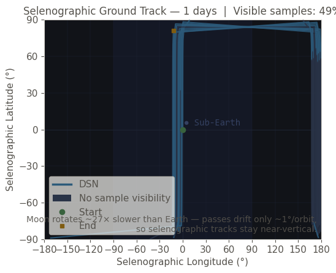
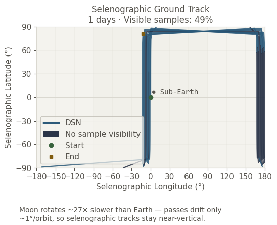
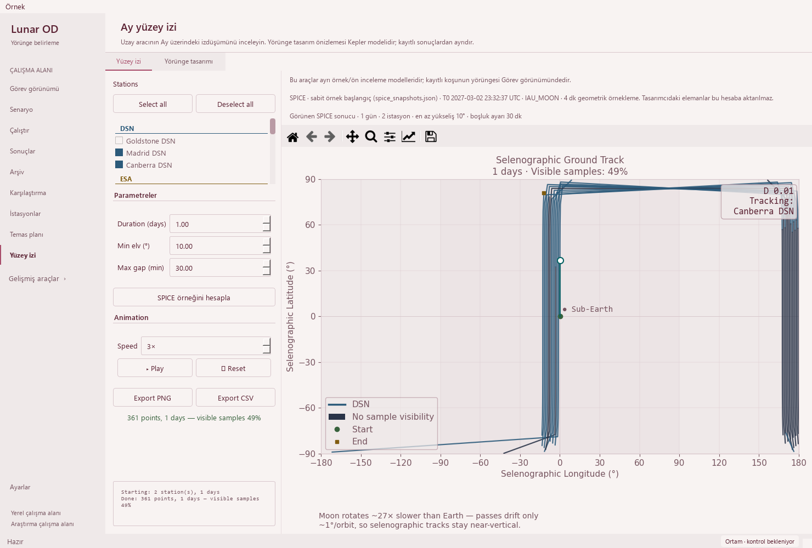

# Ground-track plot legibility — 2026-10-19

Base: `286815e56f4d463daad8814f8e2916e251794321` (PR #34).
Changed area: `_draw_moon_bg` and the title/footer layout in `_build_static_figure`.

## Reproduced problems

The Moon map kept fixed dark fills while the application used the selected light
Modern/Orchid palette. Its Sub-Earth label had a minimum foreground/background
contrast ratio of **1.72**. The long one-line title extended beyond a 548 px
canvas, and its explanatory annotation overlapped the legend at narrow widths.
The analytical preview's annotation also extended outside the canvas at 548 px.

Eight new cases failed the baseline contrast requirement. A separate frozen-base
native render measures the actual resized canvas and confirms the clipping and
annotation/legend intersections, independently of the new renderer.





These two native Qt captures use the **same prior 361-sample SPICE example**.
They are display comparisons, not new propagation or spacecraft telemetry.

## Changes and user flow

- The map background, near-side highlight and grid use the selected palette's
  existing tokens. The Sub-Earth text uses the matching secondary text color.
  No new global palette or network/track colors are introduced.
- Split the title into two lines. Duration and sampled visibility percentage
  remain visible; analytical results still say **Visibility not computed**.
- Put the existing Moon-rotation explanation below the axes with a reserved
  margin and wrapped lines. Its complete wording and approximate numbers are
  unchanged; it no longer collides with the legend or longitude label.
- Keep all controls, exports, playback and the responsive two-tab layout from
  PR #34. Existing plot widgets/figures remain in place during window resizing.

Measured Sub-Earth contrast is now **6.84 in Modern** and
**5.27 in Orchid**, including the highlighted background. The
local acceptance target is 4.5; this is a specific text-readability check, not a
claim that the entire application has been audited for accessibility.



## Scientific and artifact boundary

**36 normalized source segments remain unchanged**: the full SPICE worker,
physical/numerical constants, numerical helpers, request/result installation,
canvas error handling, CSV/PNG serializers, animation and analytical generation/
preview methods. Only the two display helpers above and their three obsolete
fixed background-color constants change. No physics, tolerance, frame, epoch,
step, sample, station selection, visibility rule or export schema changes.

A frozen base and the revised renderer receive identical inputs. At 548, 698
and 1100 px, both sampled and analytical plots preserve all line coordinates,
LineCollection segments/scalars, map limits/ticks, track colors/markers/styles
and color-map limits. Only background/grid colors and text layout differ.
Input-array byte hashes remain unchanged in all 12 comparisons across palettes.

The original SPICE example's CSV stays byte-identical after all tab/size
changes: SHA-256 `f9f0f1a605f71bc6cbd3eecad291e1310b69a1316afc8a1c53fd943f7483bb0a`.
The independent 0.1-day analytical Generate check retains 340 samples, no UTC
claim, and an uncomputed visibility mask. PNG export succeeds; its appearance
intentionally changes and is not claimed byte-identical to the old plot.

The existing saved solver output still opens 145 truth states, four stations
and 12 measurement-sample windows. Madrid selection and linked Mission playback
advance from 21600 s to 25800 s, and to
25200 s at the minimum window. The observations are
synthetic; operational success remains 0/4, and convergence remains unknown in
that source. All eight legacy runs retain missing-data guidance, and the 48
original source-file hashes are unchanged.

## Validation

| Gate | Evidence |
| --- | --- |
| Baseline | 8/8 new readability cases fail; frozen-base native render reproduces title clipping and caption collision |
| Focused | 17 passed: text/contrast/data + model semantics + responsive tabs; 27.018 s |
| Public, external inputs isolated | 368 passed; zero failures/errors/skips; 112.063 s |
| Full local regression | 1,929 passed checks; 29 existing skips; zero failures/errors; 636.247 s |
| Native UI | Modern/Orchid; 1480 × 1000, 910 × 465, 760 × 420; both tabs and both plot models |
| Render oracle | 12 old/new comparisons; new titles/footer fit; no footer/legend or footer/x-label overlap |
| Preserved behavior | 36 source segments; plotted geometry/styles, input bytes, CSV and existing source files unchanged |

The full JUnit contains 1,958 checks, including 146 unittest subchecks and
1812 named cases. Its existing skips comprise 21
opt-in slow checks and eight unavailable external-data checks. Existing numerical
reference and historical-reproduction warnings remain visible. Durations are
validation-run times, not a performance benchmark.

The full suite ran the final production renderer before a **test-only palette
cleanup**: the new test now restores actual mutable palette tokens/dictionaries,
including pre-startup defaults, rather than applying the previous theme name.
The final 17-case focused and 368-case Public gates were rerun with that cleanup;
production code did not change. The long scientific suite was not repeated for
this test-isolation change.

Commands from the repository root using the validated environment:

```powershell
python -m pytest -p tests.desktop_preferences tests/test_ground_track_legibility.py tests/test_ground_track_models.py tests/test_ground_track_layout.py -q
python tools/run_public_checks.py --junitxml=outputs/public.xml
python -m pytest -p tests.desktop_preferences tests -q -ra --junitxml=outputs/full.xml
python -m pip check
python tools/check_repository.py
git diff --check
```

The [sanitized receipt](ground-track-legibility-receipt_2026-10-19.json) contains
JUnit hashes, frozen-base measurements, protected-source hashes and native UI/
existing-record evidence. Repository/link and dependency checks pass. Strict
MkDocs remains unavailable in the scientific runtime; the existing hosted
Documentation gate supplies it. Required Public, Documentation, Library and
Dependencies checks, plus Release qualification, must pass before normal protected
merge. No dependency, workflow or long scientific campaign was added.

## Acceptance, limits and next work

**Pass for the reproduced plot contrast, title clipping and caption collisions.**
Controls/data functionality is preserved. A small window still needs vertical
scrolling to view the whole plot. This change does not qualify a fitted orbit,
change scientific drawing performance or update published portable release assets.

- Completed: responsive forms (PR #34), selected-palette map fill, readable
  reference annotation, complete two-line title and separated explanation.
- Next: remove spare vertical space in the narrow control panel.
- Then: improve first-use wording, singular/plural units and keyboard guidance,
  preserving the distinction between saved-run Mission and independent examples.
