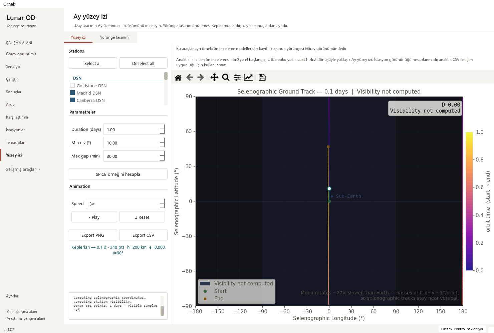

# Ground-track model and visibility labels — 2026-10-18

Base: `93921e7bcf1123820d03f429edd4a01cc9c470e4` (PR #29).
Changed area: ground-track model explanations, figure labels and playback text.

## Reproduced problems

The analytical Orbit Designer creates a `(0, n)` visibility mask: it computes
no station visibility. Its plot nevertheless reported **Coverage: 0%**, its
legend said **No coverage**, and playback said **(no coverage)**. A missing
calculation was being presented as a calculated zero. In addition, the accepted
0.1-day analytical preview was rounded to **0 days** in the plot title.

The two tools also had an ambiguous handoff description: the SPICE calculation
uses its own fixed example initial state and does not receive the designer's
orbital elements. It is not a higher-fidelity rerun of that designer result.

## Design and changes

- With an empty visibility mask, figure title, legend and playback now say
  **Visibility not computed**. Existing nonempty masks still report genuine zero
  or nonzero percentages, labelled **Visible samples**, not continuous coverage.
- Preserve fractional days in the title: 0.1 days remains 0.1 days.
- Put a short, selectable model/source caption above the displayed plot. SPICE
  identifies the fixed example fixture, actual UTC epoch, IAU_MOON and four-minute
  geometric sampling. The analytical preview identifies relative t=0, absent UTC
  epoch and the approximate constant-rate Z rotation. The caption follows the
  actual result when changing model paths.
- Explain in the designer note/tooltip that its elements do not transfer to the
  separate SPICE example. Keep the output tab neutral (**Yüzey izi**) because it
  can display either model; name the SPICE compute action explicitly.

The static page scope directs recorded-run inspection to Mission. Modern and
Orchid palettes and every existing action are retained. No layout redesign is
claimed for the ground-track page.

## Scientific and artifact boundary

No propagation, frame transforms, Kepler solver, sampling, constants, tolerances,
station coordinates, input fixtures, track geometry or CSV serialization changed.
Fifteen normalized source segments match the base: the complete `_TrackWorker`,
analytical/geometry helpers, orbit-preview helpers, designer generation and both
export methods. Hashes are in the [sanitized receipt](ground-track-models-receipt_2026-10-18.json).

The existing analytical CSV still has `network_visible=0` placeholders because its
schema is unchanged. The new caption explicitly says this analytical CSV cannot
be used as a communication-availability result. No metadata manifest or export
schema was added. Plot exports inherit the corrected title/legend.

## Verification

Five new regression cases failed against the base and passed after the change:
missing visibility, a nonempty all-false mask, an independently known 50% mask,
actual analytical generation/playback/export including fractional days, and SPICE
source/sampling labels. Controlled masks qualify UI interpretation, not physics.

    python -m pytest -p tests.desktop_preferences tests/test_ground_track_models.py tests/test_visibility_workflow.py tests/test_mission_overview.py tests/test_workspace_appearance.py tests/test_pytest_desktop_app.py -q
    python tools/run_public_checks.py --junitxml outputs/public-checks.xml
    python -m pytest -p tests.desktop_preferences tests -q -ra --junitxml outputs/full.xml

Targeted: **65 passed** (9.717 s). Public:
**327 passed** (64.343 s), including all five new model cases.
Full: **1,888 passed checks**, **29 existing skips**, zero failures/errors,
610.339 s. JUnit contains 1,917 checks:
1771 named cases plus 146 subtest checks.

| Local JUnit | SHA-256 |
| --- | --- |
| Targeted | `49989c9b604e6f21607f8f2d7a70cc15d75dbdf8058f325cb551084702aa6f87` |
| Public | `32e9294353920642b1d62089c7acd9a7305266e606e56188a68ba318260d98cf` |
| Full | `69039784f407455c47d7fd43af298fa206c2246d9f4e86e3d67fbb3fc954f5da` |

Native Qt offscreen review used Modern at scale 1 and Orchid at scale 2, at
1480×1000, 910×465 and 760×420. The unchanged actual worker ran bounded one-day
Madrid + Canberra calculations: 361 samples, 240 s step, fixture epoch
2027-03-02 23:32:37 UTC. The actual analytical generator produced 340 samples
for 0.1 day. Neither is recorded spacecraft telemetry.

Plot coordinates, line/collection arrays, collection scalar arrays and axis data limits match
the committed-base renderer exactly. Source arrays remain intact. Original and
current CSV serializers produced identical bytes in both palettes, for each model.
Animation advanced, model captions followed source changes, and all compute,
parameter, export and playback controls remained reachable with existing scrolls.
Screenshots were reviewed after canvas painting; the first premature capture was
replaced after waiting for the Qt paint event. This was a capture-timing issue.

The existing solver-output workflow reopened 145 truth states, four stations and
12 measurement-sample windows; playback and station selection worked. Synthetic
observations, four false operational-success flags and unverified convergence
remain explicit. Both small Mission layouts passed. Eight older runs retained
missing-data guidance, and all 48 source hashes were unchanged.

Repository/link, dependency-consistency and whitespace checks passed. The local
graph was refreshed for the new UI helper. No dependency or workflow configuration
was added; the existing public test list includes the new module. Hosted docs,
library, public, dependency and release gates must pass before normal PR merge.
Local strict docs were not run because MkDocs is absent from the validated runtime.
No long scientific campaign was run.

## Interpretation and remaining work

**Pass with caveats:** this corrects displayed meaning and source explanations,
with unchanged scientific arrays and serialized numerical values. The ground-track
page retains its existing horizontal scrolling: 252 px at 910×465 and 402 px at
760×420. PR #29's zero-horizontal-scroll change applies to Temas planı, not this page.

- Model provenance, missing versus calculated-zero visibility and fractional-day
  labels: complete here.
- Next: inspect ground-track pending/edited/failed result consistency, and profile
  the designer preview timer while its tab or page is hidden.
- Consider responsive ground-track layout in a separate iteration.
- Profile larger saved-run workflows when representative recordings are available.
