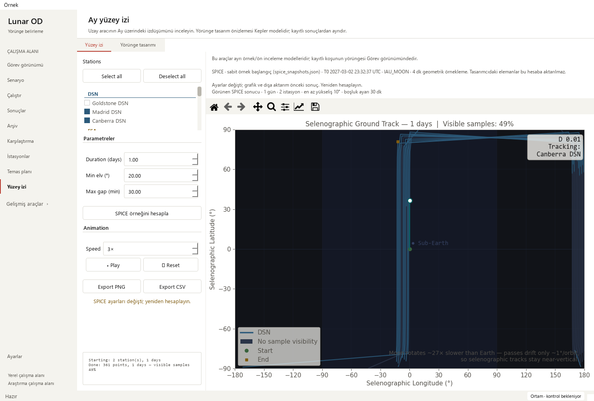

# Ground-track request context and model ordering — 2026-10-18

Base: `2b66d9d572fe9abd8593dc3c1eb04d4e14eb35f6` (PR #32).
Changed area: independent ground-track request controls and displayed-result context.

## Reproduced issues

SPICE inputs remained editable during an asynchronous request, and revisiting the
page resynchronized duration from global settings. A frozen-base native probe
started a one-day request, then displayed seven days after a settings resync while
the worker still held one day. There was no caption tying the plot/export to the
original elevation, gap setting or station selection after edits.

The designer could also generate an analytical track while SPICE was pending;
the later SPICE response silently replaced that newer analytical view. The probe
reproduced both replacements. These request-order checks use a controlled pending
worker; they do not qualify a new scientific computation.

The initial 13-case regression module failed all 13 cases against the base.

## Changes and user flow

- Capture selected stations, duration, elevation and gap setting when starting
  SPICE; send that same snapshot to the unchanged worker. Freeze those inputs
  and custom page exports/playback while the request is pending. Skip global
  duration resync until it finishes.
- Keep the designer preview and its parameters available. Disable its generation
  button with an explicit **SPICE hesabı sürüyor…** explanation. Guard both
  generation and result installation, so no analytical propagation/result can
  overtake the pending SPICE request.
- Add a compact caption for the **displayed** result's actual duration, station
  count and captured request settings. Exact station names are in its tooltip;
  the caption is selectable and accessible. Edits explicitly label the graph/export as the previous
  result; restoring the original settings clears that notice.
- Capture analytical elements separately and expose them with named units in the
  tooltip. SPICE input edits do not relabel an analytical result. Direct results
  with no captured request metadata say settings were not recorded; current
  controls are never substituted as their original thresholds.
- On worker/render failure, restore controls and the matching previous result's
  metadata and paused playback. Successful retries replace metadata only after
  the existing atomic result installation succeeds. No selected station disables
  SPICE compute, while the independent designer remains usable.
- Explain that the gap setting is passed to analysis, while the plot/CSV uses the
  raw sampled visibility mask. No filled contact windows are claimed.

## Scientific and artifact boundary

The receipt verifies **34 normalized source segments unchanged**,
including the full SPICE worker, module-level numerical/plot helpers, static
renderer, canvas/result installation, animation/reset/lifecycle and CSV/PNG
serializers. The analytical generation function has only a new early busy guard;
its remaining AST is identical to the base. Physics, frames, sample spacing,
fixtures, tolerances and export schemas remain unchanged.

Native checks replay the existing 361-sample SPICE example CSV from the
[model-label review](ground-track-models_2026-10-18.md), verifying its hash against
the preceding receipt before loading:
`f9f0f1a605f71bc6cbd3eecad291e1310b69a1316afc8a1c53fd943f7483bb0a`.
The pending-worker replay exercises UI orchestration and captured-request
labels; it is not a new SPICE solution or telemetry qualification. Analytical
retry uses the existing 0.1-day two-body model (340 samples); station visibility
remains uncomputed. Raw arrays and exported CSV bytes stay identical through
input edits, pending/failure recovery and small-window resizing. PNG export uses
the retained figure successfully; pixel identity across caption/layout changes
is not claimed.

## Verification

Oracles: exact worker arguments; control enablement; zero analytical propagation
calls while SPICE is pending; displayed result/figure identity and sample index;
independent captured versus edited settings; CSV contents/hashes; honest unknown
metadata; and successful retry of each model. No baseline, seed or numerical
tolerance was changed.

    python -m pytest -p tests.desktop_preferences tests/test_ground_track_workflow.py tests/test_ground_track_results.py tests/test_ground_track_lifecycle.py tests/test_ground_track_models.py tests/test_visibility_workflow.py tests/test_mission_overview.py tests/test_workspace_appearance.py tests/test_pytest_desktop_app.py -q
    python tools/run_public_checks.py --junitxml outputs/public-checks.xml
    python -m pytest -p tests.desktop_preferences tests -q -ra --junitxml outputs/full.xml

Targeted: **94 passed** (26.219 s).
Public: **356 passed** (79.587 s), including the new 13 cases.
Full: **1,917 passed checks**, **29 existing skips**, zero failures/errors
(499.194 s). JUnit contains 1,946 checks:
1800 named cases plus 146 subtest checks.

| Local JUnit | SHA-256 |
| --- | --- |
| Targeted | `b639a2c1be5845c70e8dc1567ac67a411e6662dc2a7553b112076f0346c3afad` |
| Public | `506f8a1f5f112aa2c4cc232aa9aacbc0f5bd7dad6e018b0456c516c6d38b8603` |
| Full | `f82f8ccce78bbe916cb27b53e68695c070e511e5277324ea05fd2cf969aae5cc` |

Native offscreen Qt review passed Modern (scale 1) and Orchid (scale 2), at
1480×1000, 910×465 and 760×420. Busy controls, designer explanation, edited-result
caption and small-window controls/status were inspected. Input navigation did
not change the pending request, blocked generation performed zero propagation
calls, failure retained the 10° result during a 20° request, and explicit Play
and retries worked. Existing horizontal scroll remains 252/402 px; caption labels
are internally unclipped but require existing panning on small windows. The
left-side status cue and controls remain reachable by vertical scrolling.

The existing solver-output workflow still reopens 145 truth states, four
stations and 12 measurement-sample windows, with station selection and linked
playback in both small Mission layouts. Observations remain synthetic; all four
operational-success flags are false and convergence is explicitly unknown.
Eight legacy runs retain missing-data guidance and all 48 source-file hashes.

The [sanitized receipt](ground-track-request-context-receipt_2026-10-18.json)
contains native probes, source hashes and test receipts. Dependency,
repository/link and whitespace checks passed; the local graph was refreshed.
No dependency or CI workflow was added. Existing hosted public, docs, library,
dependency and release PR gates must pass before normal protected merge. Local
strict docs were not run because MkDocs is absent from the scientific runtime;
the hosted docs gate supplies that check. No long campaign was run.

## Limits and next work

**Pass for the reproduced editable-request and model-ordering issues.** Request
metadata is held with this page's in-memory result; existing raw export formats
are unchanged. The page's custom export buttons pause during a request; the
existing Matplotlib toolbar still operates on the visibly identified old figure.
This does not redesign the layout or change large-record drawing performance.

- Model/source labels, hidden timers and matching result retention: PRs #30–32.
- Pending SPICE input snapshots, ordering and displayed-result provenance: complete here.
- Next: responsive ground-track panels and readable plot-label contrast.
- Then: update first-use wording and inspect keyboard access across these tools;
  retain all controls and the distinction from saved-run Mission playback.
