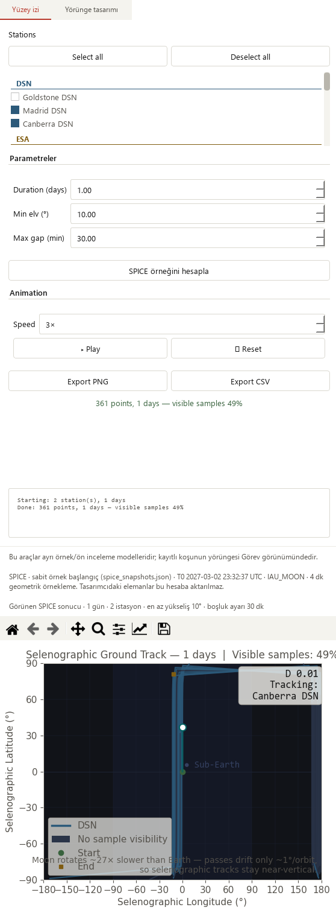
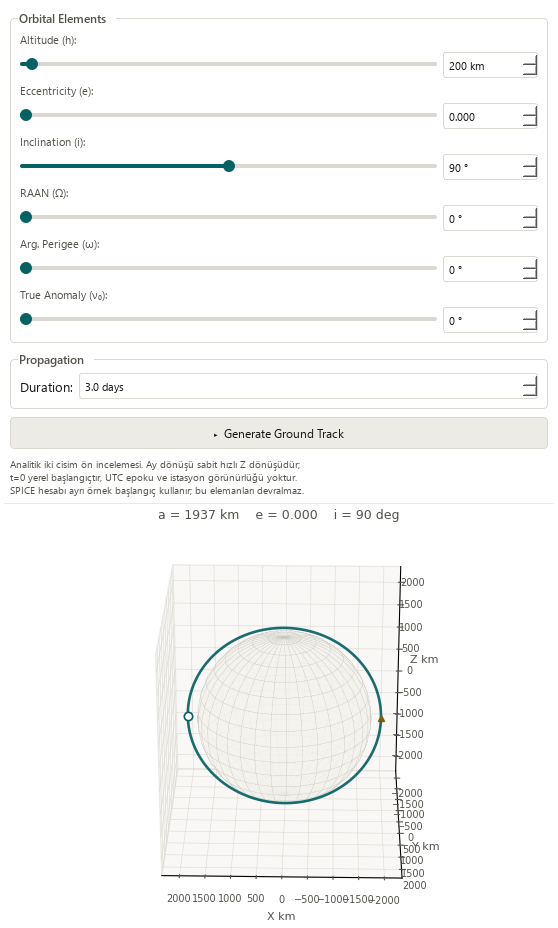

# Responsive ground-track workspace — 2026-10-19

Base: `cadd2f4ba7bd38bc0e43ccb93ee71a3fedf55d32` (PR #33).
Area: the **Yüzey izi** and **Yörünge tasarımı** widget layouts.

## Reproduced issue and decision

Both tabs forced a 960 px page into a smaller content viewport. At main-window
sizes 910 × 465 and 760 × 420, the horizontal scroll range was 252 and 402 px.
Reading the result caption, editing orbit elements and seeing the plot required
horizontal panning. All four new regression cases failed on that baseline.

Keep the existing wide arrangement. In a narrow content viewport, put the full
form above the plot, with the page's outer vertical scroll exposing all controls.
Keep the station catalogue's own bounded list scroll. The designer's parameter
form needs no second vertical scrollbar in narrow mode.

## Changes and usage

- The main page now allows the same smaller content width as Mission, Stations
  and Visibility. Other nonresponsive pages retain their existing 960 px minimum.
- Below 900 px of **page content** width, the track controls stack above the
  chart, while the designer puts its elements, duration and Generate button
  above a 420 px preview. The splitter returns to its wide arrangement on resize.
- Compute, Play/Reset, CSV/PNG export, request status, logs and source captions
  remain reachable with vertical scrolling. Wrapping captions and dynamic logs
  contribute to the required height; the track canvas retains over 360 px.
- Tab sizing uses the visible form's minimum. A hidden tall form no longer
  forces excess height on the active tab. Resizing reuses existing widgets and
  figures, preserving values, result identity and paused playback position.
- Preview rotation still runs only while its designer tab is visible. Keyboard
  entry still edits the element form, and explicit Generate still creates the
  independent analytical result and returns to the track tab.

These images capture the **complete scrollable page**, not all content being
simultaneously visible in a 420 px high window.





## Scientific boundary and existing records

**38 normalized source segments are unchanged**, including the full SPICE
worker, numerical constants, module-level helpers/static renderer, request
handling, result/canvas installation, animation and exports, and the analytical
generation/preview methods. No solver, frame, time, tolerance, step, visibility
mask or serialized CSV field changed.

Both palettes replay the prior hashed 361-sample SPICE **example** through a
controlled worker. This is not a new propagation, saved-run reconstruction or
spacecraft telemetry test. The CSV remains byte-identical after all tab/size
changes, SHA-256 `f9f0f1a605f71bc6cbd3eecad291e1310b69a1316afc8a1c53fd943f7483bb0a`.
Array bytes, the track figure/canvas, result caption and paused sample index stay
unchanged. The analytical 0.1-day keyboard/Generate check produces 340 samples,
with visibility explicitly uncomputed.

The existing saved solver output still opens 145 truth states, four stations
and 12 **measurement-sample** windows. Madrid selection and linked playback
(21600 → 25800 s) work in Mission, including its minimum window. Observations
remain synthetic; all four operational-success flags are false, and convergence
is unknown in that source. Eight legacy runs retain missing-geometry/time
guidance; all 48 original source hashes are unchanged.

## Validation

| Gate | Evidence |
| --- | --- |
| Baseline | 4/4 new layout cases fail on the horizontal scroll constraint |
| Final focused UI subset | 107 passed within the final Public gate |
| Public, external inputs isolated | 360 passed; 0 failures/errors/skips; 100.613 s |
| Full local regression | 1,921 passed checks; 29 existing skips (optional data / opt-in slow checks); 0 failures/errors; 677.102 s |
| Native Qt review | Modern and Orchid; 1480 × 1000, 910 × 465 and 760 × 420; both tabs |
| Narrow access | horizontal scroll 0; all actions/spins/captions reachable; designer inner vertical scroll 0 |
| Source/artifact identity | 38 protected source segments; CSV and original saved/archive files unchanged |

The full JUnit records 1,950 checks, including 146 unittest subchecks; it contains
1804 named cases. Timings are validation-run durations,
not responsiveness benchmarks. The 29 skips comprise 21 opt-in slow checks
and eight checks requiring unavailable external data. Existing numerical-reference
and historical-reproduction warnings are retained, not suppressed. The initial focused 107-case run preceded the
final wrapped-control height/status resize hooks; the final Public run covers
all those same cases on the final implementation.

Reproduction (from the repository root, using the validated environment):

```powershell
python -m pytest -p tests.desktop_preferences tests/test_ground_track_layout.py tests/test_ground_track_workflow.py tests/test_ground_track_results.py tests/test_ground_track_lifecycle.py tests/test_ground_track_models.py tests/test_visibility_workflow.py tests/test_mission_overview.py tests/test_station_catalog_filters.py -q
python tools/run_public_checks.py --junitxml=outputs/public.xml
python -m pytest -p tests.desktop_preferences tests -q -ra --junitxml=outputs/full.xml
python -m pip check
python tools/check_repository.py
git diff --check
```

The [sanitized receipt](ground-track-responsive-receipt_2026-10-19.json) retains
JUnit hashes and native layout/source evidence. Dependency and repository/link
checks pass. The local dependency graph is refreshed without LLM relabeling.
Strict MkDocs is unavailable in the local scientific runtime; the existing hosted
Documentation gate supplies that verification. Existing protected Public,
Documentation, Library and Dependencies gates, plus Release qualification, must
pass before a normal merge. No dependency, workflow or long campaign was added.

## Acceptance and next work

**Pass for the reproduced horizontal panning and narrow form access issues.**
All functionality remains present. Small windows need vertical scrolling; this
change does not make the full workspace fit above the fold. It does not improve
large-record scientific drawing speed or qualify an OD fit.

- Completed: responsive track/designer panels, captions, all actions and width round trips.
- Next: plot-label contrast and compact/wrapped titles. Visual review still finds
  low-contrast annotations on the dark Moon background and a cropped long plot
  title at the narrow width. The static renderer is deliberately unchanged here.
- Then: reduce spare vertical space in the narrow track control panel and review
  first-use wording/keyboard guidance while preserving source/units/model distinctions.
