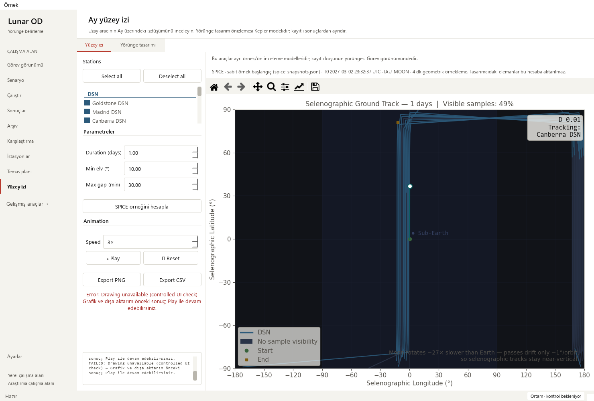

# Ground-track result consistency on render failure — 2026-10-18

Base: `d5eea8612e3dece111361bd8ee65d94773cb954f` (PR #31).
Changed area: installation of native Qt ground-track results and error guidance.

## Reproduced issue

Both SPICE and analytical result handlers assigned new data before building the
new figure. A controlled renderer failure left the old canvas and figure visible
with new CSV data and both export buttons enabled. A native frozen-base probe
reproduced a Madrid displayed result paired with a Goldstone CSV payload through
both handlers. Those are controlled UI samples, not scientific calculations.
Errors escaped the handlers. The old worker-error path also disabled playback
of a valid previous result without explaining what its exports represented.

The new 12-case module ran against the unedited base controller first:
**10 failed, two successful-replacement cases passed**. Figure-construction and
first-draw failure cases cover both new-result paths, with/without a prior result.

## Changes

- Prepare the figure, all animated artists, Qt canvas and toolbar, and complete
  the first synchronous draw before removing the previous canvas.
- Install data, figure, animation references and reset index together after that
  preparation succeeds. Use the same path for both models. Clean up candidate
  Qt widgets when preparing/drawing them fails.
- On a detected computation or render failure, pause playback, preserve the
  matching previous data/figure/canvas/model explanation and playback index,
  and explicitly say the visible graph and exports are the previous result.
  Restore Play and exports only when that result exists.
- With no previous result, keep the placeholder and exports/playback unavailable;
  explain that no result was produced. A subsequent successful result replaces
  the whole pair normally. Detailed render errors remain in the dialog.

## Scientific and artifact boundary

The worker, static renderer, all module-level numerical/plot helpers, orbit
preview/generation, animation-step/reset, CSV/PNG serializers, and previously
fixed visibility/timer behavior match the base as normalized source segments.
The receipt records **33 unchanged segments** and their hashes.
Only UI result-installation order, initial drawing and failure handling change;
physics, sampling, frames, fixtures, tolerances, export schemas and raw values
remain unchanged.

Native checks replay the existing **361-sample computed SPICE example CSV** from
the [model-label review](ground-track-models_2026-10-18.md), checking its source
hash against that prior receipt before loading:
`f9f0f1a605f71bc6cbd3eecad291e1310b69a1316afc8a1c53fd943f7483bb0a`.
This is example-computation replay, not spacecraft telemetry or a new SPICE
propagation. Analytical retry uses the existing two-body designer at 0.1 day
(340 samples); station visibility remains explicitly uncomputed.

For each palette, **CSV and PNG bytes before/after each controlled failure are
identical within that palette**. PNGs intentionally differ between themes. The
same data, canvas, figure, artists, model note and paused sample survive; explicit
Play resumes, and successful retries of both models replace the result.

## Verification

Oracles are baseline mismatch reproduction, object identity, exact CSV rows and
artifact hashes, controlled failures at figure construction and synchronous
canvas draw, preserved sample index, and normal replacement/resume behavior.
No baseline, random seed or tolerance was changed.

    python -m pytest -p tests.desktop_preferences tests/test_ground_track_results.py tests/test_ground_track_lifecycle.py tests/test_ground_track_models.py tests/test_visibility_workflow.py tests/test_mission_overview.py tests/test_workspace_appearance.py tests/test_pytest_desktop_app.py -q
    python tools/run_public_checks.py --junitxml outputs/public-checks.xml
    python -m pytest -p tests.desktop_preferences tests -q -ra --junitxml outputs/full.xml

Targeted: **81 passed** (30.006 s).
Public: **343 passed** (107.419 s), including all 12 new cases.
Full: **1,904 passed checks**, **29 existing skips**, zero failures/errors
(1235.033 s). JUnit has 1,933 checks:
1787 named cases plus 146 subtest checks.

| Local JUnit | SHA-256 |
| --- | --- |
| Targeted | `92df056e003db37d4d087b8bca76e0e2ac544a7616f0b5b2b5ae01546a44e859` |
| Public | `8c2f06b2ffcd23d28e8e1870da024bd4b953d1e50c379c5734f565a4ce94cb62` |
| Full | `c0dd71a4747f21760a189b661b34f9d27ce7e8d4775c99e0e538c5d2efb2a689` |

Native offscreen Qt review passed Modern (scale 1) and Orchid (scale 2), at
1480×1000, 910×465 and 760×420. Four controlled failures per palette retained
matching CSV/PNG bytes and a readable previous-result warning. Controls remain
reachable using the existing scrolls; screenshots of retained errors and
successful retries were inspected. Initial hidden preview remains idle.

The existing solver-output workflow reopened 145 truth states, four stations and
12 measurement-sample windows; station selection and linked playback still
work, including both small Mission layouts. Observations remain synthetic;
four false operational-success flags and unknown convergence remain explicit.
Eight legacy runs preserve missing-data guidance and all 48 source-file hashes.

The [sanitized receipt](ground-track-result-pair-receipt_2026-10-18.json) contains
baseline/current probes, test receipts and source hashes. Dependency,
repository/link and whitespace checks passed; the local graph was refreshed.
No new dependency or CI workflow was introduced. Existing public, docs, library,
dependency and release PR gates must pass before normal protected merge. Local
strict docs were not run because MkDocs is absent from the scientific runtime;
the hosted docs gate provides that check. No long campaign was run.

## Limits and next work

**Pass for the reproduced synchronous render/worker error paths.** This does not
catch arbitrary later OS/Qt repaint or export I/O failures. The first draw is
synchronous; no performance speedup is claimed. Ground-track request/input snapshots and concurrent SPICE
versus designer requests remain a separate follow-up. Existing horizontal panning
is still 252/402 px at the two small sizes; this change adds no responsive layout.

- Model/source/unknown-visibility labels: complete in PR #30.
- Hidden animation timer lifecycle: complete in PR #31.
- Matching ground-track result/export retention after detected errors: complete here.
- Next: pending/edited input context and SPICE/designer request ordering.
- Then: responsive ground-track panels and plot-label contrast; preserve every tool.
