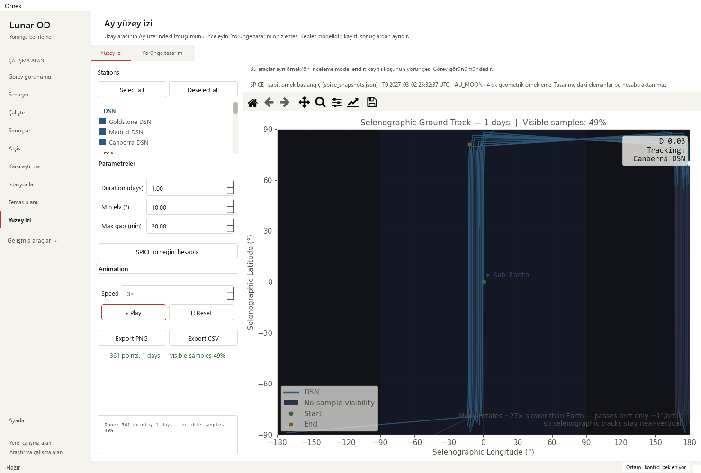

# Ground-track animation timer lifecycle — 2026-10-18

Base: `dfdaf4ba17247ed7c82c063e304bdabe95a79bb7` (PR #30).
Changed area: Qt timer visibility and playback pause/resume behavior.

## Reproduced issue

The designer already stopped its 3-D timer on hide events, but its constructor
started the timer before that tab had ever been shown. The initially hidden tab
therefore kept rotating/redrawing. Ground-track playback also kept advancing when
switching to Mission or the designer tab, and on closing a retained window.

An actual native baseline probe measured **8 hidden preview callbacks in 600 ms**.
After leaving playing ground track for Mission, a 650 ms observation saw **5
preview + 5 playback callbacks**, with playback index **6 → 21** while hidden.
These are bounded event counts from one probe, not CPU/fps benchmarks.
Four integration cases failed against the exact frozen base module.

## Design and changes

- Start the existing 66 ms preview timer through its existing `showEvent` path;
  retain its existing hide behavior. The never-opened designer stays idle.
- Pause ground-track playback on leaving the page or selecting the designer tab.
  Keep the sample index, loaded data, figure and marker state. Returning stays
  paused; the user presses **Play** to continue at the same position.
- Guard Play when its view is hidden, stop both timers on window shutdown, and
  explain the pause/resume behavior in the existing Play button's tooltip.
- Keep visible rotation, playback speeds, manual pause, Reset and exports.
  No new controls, theme or layout changes are introduced.

## Scientific and artifact boundary

The worker, renderer, propagation and Kepler helpers, visible animation-step
algorithm, reset, preview rotation, generation and CSV/PNG serializers match the
base as normalized source segments. The native receipt records
30 unchanged segments and their hashes. This change schedules
existing visualization work; it does not change physics, tolerances, sampling,
input files, numerical baselines or export schemas.

Native checks replayed the existing **361-sample computed SPICE example CSV**
from the [preceding model-label review](ground-track-models_2026-10-18.md).
Its SHA-256 was checked against that review's receipt before loading:
`f9f0f1a605f71bc6cbd3eecad291e1310b69a1316afc8a1c53fd943f7483bb0a`.
It is a replay of that example computation, not a new propagation or recorded
spacecraft telemetry. Loaded replay arrays and exported CSV bytes remain identical
through page/tab hiding, manual resume, reset and closing. The same data and
figure objects are retained.

## Test plan and verification

Oracles are actual QTimer signal counts, visible preview phase advance, hidden
phase/index stability, Play/Reset operation, retained object identity and exact
CSV/array hashes. No random seed, tolerance or stored baseline was changed.

    python -m pytest -p tests.desktop_preferences tests/test_ground_track_lifecycle.py tests/test_ground_track_models.py tests/test_visibility_workflow.py tests/test_mission_overview.py tests/test_workspace_appearance.py tests/test_pytest_desktop_app.py -q
    python tools/run_public_checks.py --junitxml outputs/public-checks.xml
    python -m pytest -p tests.desktop_preferences tests -q -ra --junitxml outputs/full.xml

Targeted: **69 passed** (11.841 s). Public:
**331 passed** (59.448 s), including all four lifecycle cases.
Full: **1,892 passed checks**, **29 existing skips**, zero failures/errors,
391.46 s. JUnit contains 1,921 checks:
1775 named cases plus 146 subtest checks.

| Local JUnit | SHA-256 |
| --- | --- |
| Targeted | `e1154ea0604af75f17d35dea3577ba213bdf4c1e57d78abe4cdea71078de2dcd` |
| Public | `535c3472980cf329c693e0370380315496bb3bfada7618767d7126207f7fa4b5` |
| Full | `2bdffb9eb7cd13bd02f92f265af5d69cfe60616b33bd40d2520f3ddbcd9e4118` |

Native Qt offscreen review passed in Modern (scale 1) and Orchid (scale 2), at
1480×1000, 910×465 and 760×420. Both palettes had **zero initial hidden preview
callbacks over 600 ms**, and **zero hidden preview/playback callbacks over 650 ms**
after switching page. The visible preview still rotated, playback resumed only
on an explicit Play, and Reset/close behaved correctly. Screenshots of visible
preview, paused return and small-window controls were inspected. Existing scrolls
kept controls accessible; normal scrollbars completed the Qt focus rectangle to
expose full spinbox borders.

The existing solver-output workflow reopened 145 truth states, four stations and
12 measurement-sample windows. Playback and station selection still worked in
both small Mission layouts. Its observations remain synthetic; four false
operational-success flags and unknown convergence remain explicit. Eight legacy
runs kept missing-data guidance and all 48 original source hashes.

The [sanitized receipt](ground-track-timers-receipt_2026-10-18.json) contains the
before/after probe, checks and source hashes. Repository/link, dependency and
whitespace checks passed. The local graph was refreshed for the added lifecycle
callbacks. The existing public runner includes the new module; no dependency or
workflow configuration was added. Existing hosted public, docs, library,
dependency and release gates must pass before normal merge. Local strict docs
were not run because MkDocs is absent from the validated scientific runtime.
No long scientific campaign was run.

## Interpretation and next work

**Pass with caveats:** repeated timer work stops while these Qt views are hidden,
and returning does not jump the user's playback position. Counts demonstrate
elimination of that hidden loop; no overall CPU, battery or application-wide
speedup percentage is claimed. Explicit parameter edits may still request a
redraw. OS window occlusion/minimization and other pages' animations are outside
this focused change. Existing ground-track panning remains 252/402 px at the two
small sizes.

- Ground-track model/duration labels: complete in PR #30.
- Hidden startup preview and hidden playback timer lifecycle: complete here.
- Next: inspect pending/edited/failed ground-track result consistency.
- Consider responsive ground-track layout separately; profile larger saved-run
  workflows when representative source recordings are available.
