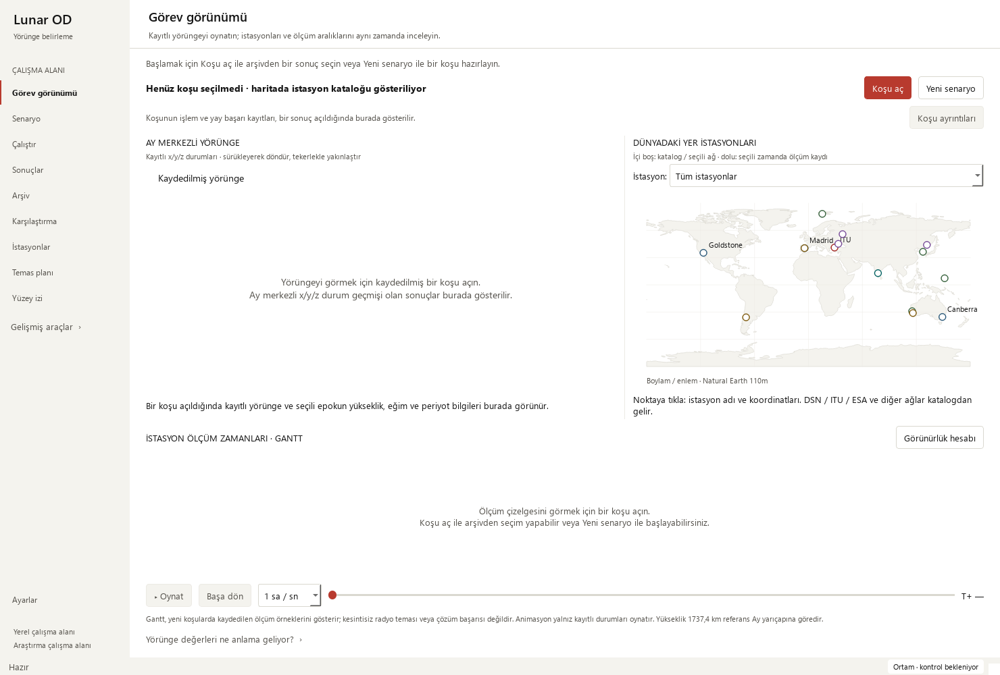

# First-run guidance — 2026-10-12

Base: fb13f2a3bcab0717cf780fc80dc7a3f4d817e87d. Focused Qt copy and
accessibility changes; scientific code, recorded sources, numerical tolerances
and acceptance rules are unchanged.

## Observed problem and change

Before opening any result, the orbit said that "this result" had no state vector
and the Gantt said that "this run" had no measurement times. Those messages
describe incomplete loaded data and were misleading on a fresh workspace.

- Initial plots now explain how to open a saved run. The page introduction
  points to **Koşu aç** and **Yeni senaryo**.
- After loading a run, the introduction explains station selection and playback.
  Missing-data messages remain explicit when that loaded source lacks history
  or station geometry.
- The same contextual text is exposed in Qt accessibility descriptions. Loading
  usable data clears the empty description; resetting a plot restores opening
  guidance and invalidates the previously drawn data.
- No layout, palette, scientific calculation or artifact contract changed.

## Verification

    python -m pytest -p tests.desktop_preferences tests/test_mission_overview.py tests/test_tracking_render_semantics.py tests/test_large_workspace.py -q

38 passed. The new state-transition contract distinguishes unopened, incomplete,
usable and reset widgets through their accessible descriptions. Existing
rendering, stored-time playback, source-hash and large-data cases remain green.
The test does not certify a particular assistive-technology device.

The isolated public gate passed **265 cases** in 31.243 seconds, with no skips,
failures or errors. The full local regression passed **1,793 checks**, with 29
existing skips and zero failures/errors, in 272.590 seconds. Its JUnit report
contains 1,822 checks: 1,676 named cases and 146 subtest checks. Existing optional
slow/data-dependent skips were retained; no numerical tolerances were changed.

Local JUnit receipt SHA-256 hashes:

| Receipt | SHA-256 |
| --- | --- |
| Public | `05F71DE423381CE0A5EB8DB96B3FE49AE63E841528738922F13F63EDBE918516` |
| Full | `06000276A9C86632DFA82ED804658A6685EB93F612AC3A0AA1967CB9B59711C3` |

Native Qt screens were inspected: initial and loaded 1480×1000 views, then
910×465 and 760×420 loaded layouts with accessible controls and no horizontal
scroll range. The existing verified 24-hour solver output retained all source
hashes after selection/playback/rendering. Its observations are synthetic and
all four arc-success flags remain false. Eight legacy runs reopened; all 48
verified source files retained their hashes, and missing geometry stayed explicit.

The [sanitized receipt](mission-onboarding-receipt_2026-10-12.json) records these
checks. UI verification does not establish estimator convergence.

## Remaining design work

- Review remaining specialist pages for clear units, short explanations and
  keyboard access.
- Check dense station-label overlap and map proportions across viewport sizes.
- Profile slow workflows against representative large saved runs when available.
