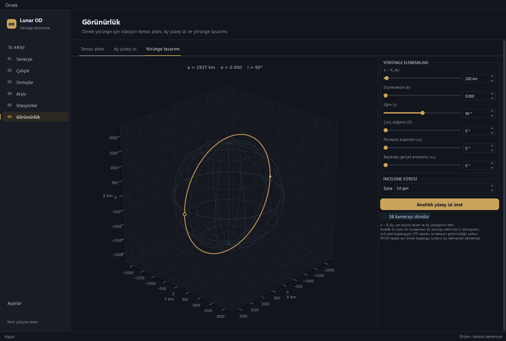
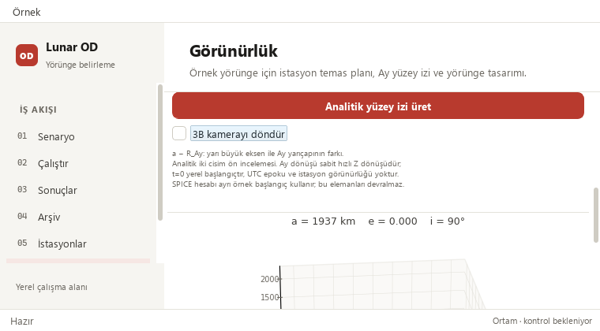

# Pause the orbit camera for inspection

The analytical designer now has **3B kamerayı döndür**, a keyboard-accessible
checkbox. Turning it off stops automatic camera movement so an inspection angle
is no longer overwritten by the next timer tick. Its help distinguishes camera
movement from recorded-run time and analytical generation.

## Behavior and scope

- Rotation starts enabled, preserving the existing startup behavior and 66 ms
  timer interval. Turning it off stops the timer and camera redraw requests.
- The selected angle stays still during paused animation ticks. Orbital fields
  remain editable; explicit edits retain the existing preview rebuild/view reset.
- The choice survives navigation between pages/tabs within this window. It is
  session-local. Showing a paused designer does not silently restart rotation.
- Generate, station inputs, stored results, CSV exports and recorded-run playback
  keep their separate existing behavior. The checkbox changes only camera state.
- Tab after Generate reaches the entire checkbox even at 760 × 420; Space toggles
  it. Existing field order and focus/scroll guidance stay intact.

Source scope: four existing widget methods plus one new timer-state method.
All 72 other source segments match base `d637c44b2f151067267c46c41434398a4b5bfe00`,
including Kepler/SPICE calculations, guards, result installation and exports.
The rendering improvements already merged in PR #52 are preserved.





## Verification

- 73 targeted UI cases and 398 isolated public checks pass without skips.
- Full regression: 2042 passed checks, 29 existing skips,
  1925 named cases; no failures/errors. Counts include unittest subchecks.
- The isolated runtime passes 15 import-isolation/Numba-parity checks. Its
  third-party package versions match the original verified runtime; the editable
  project installation points to this checkout and shared scientific data are
  explicitly configured read-only. The initial misconfigured full attempt was
  excluded and corrected before qualification; no test or tolerance was weakened.
- Twelve native camera states cover Gece, Modern and Orchid at wide/minimum
  sizes. All six paused samples have zero camera draws; all active samples rotate.
  The exact base callback overwrites a simulated manual angle; the paused callback
  preserves it. Real Qt Tab/Space input reaches and operates the checkbox.
- Twenty-seven additional native preview states cover three sizes and all three
  palettes. Stored circular/eccentric analytical CSVs retain their historical
  hashes. A prior 361-row SPICE example is replayed with identical CSV; no new
  SPICE propagation is needed.
- The stored solver-output run retains 145 truth states, four stations, 12
  measurement-sample windows, Madrid selection and linked orbit/Gantt playback
  21600 → 25800 s. Its observations are synthetic; operational success remains
  0/4 and convergence is unknown. Eight legacy runs retain all 48 source hashes.
- Dependency, repository and whitespace gates pass. Scientific source/artifacts,
  tolerances, dependencies, workflow files, release tags and portable assets are
  unchanged by this feature.

```powershell
python -m pytest -p tests.desktop_preferences tests/test_orbit_designer_guidance.py -q
python tools/run_public_checks.py --junitxml=outputs/public.xml
python -m pytest -p tests.desktop_preferences tests -q -ra --junitxml=outputs/full.xml
python -m pip check
python tools/check_repository.py
git diff --check
```

For an isolated checkout, install it editable into its own verified environment
and set `LUNAR_OD_PROJECT_ROOT` to the shared read-only project-data directory.
See the [sanitized receipt](orbit-camera-control_2026-10-25-receipt.json). Required GitHub checks and
Release qualification precede protected merge; exact merged-main checks and
downloaded JUnit receive a separate local receipt outside Git.

## Next review

- Consider retaining a paused inspection pose across explicit parameter edits;
  current rebuild behavior is preserved in this change.
- Re-profile visible rendering only if a fresh bottleneck is demonstrated. Earlier
  sphere/layout timings predate PR #52 and must not drive duplicate optimizations.
- Native Windows/high-DPI mouse gestures remain outside offscreen qualification.
  The existing modal-painting limitation is unchanged; original dialogs stay intact.
- Preserve concurrent worktrees; no user application restart in this change.
