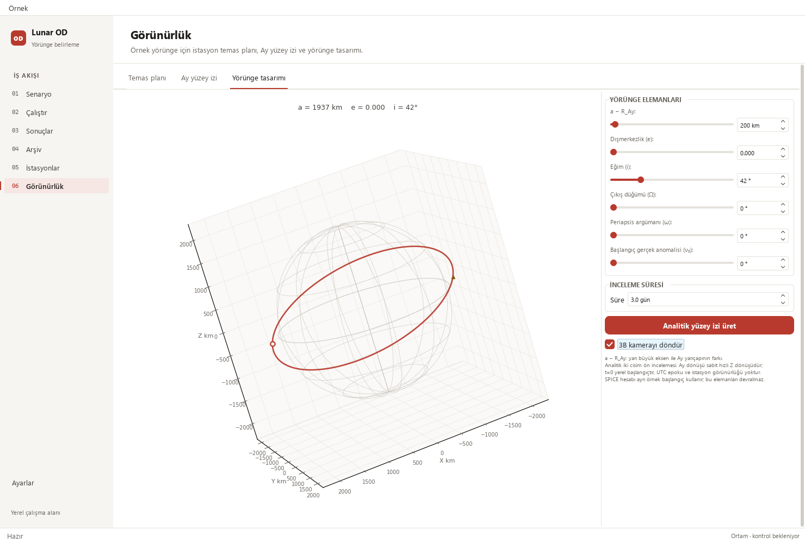
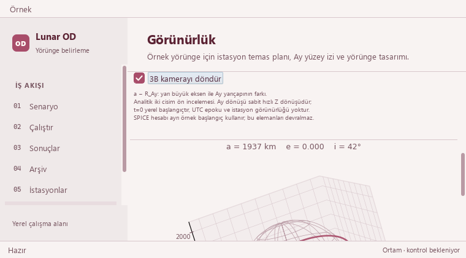

# Resume orbit-camera rotation from the inspected view

Re-enabling **3B kamerayı döndür** used to overwrite an inspected camera pose on
the next frame. For example, elevation/azimuth/roll `(13°, 73°, 17°)` jumped to
`(25°, 2.4°, 0°)`. Rotation now advances only the current azimuth by the existing
2.4° step; elevation and roll stay as inspected. A manual drag during rotation
also becomes the starting view for the following frame. The checkbox help
explains that resuming continues from the selected angle.

The 66 ms timer, default enabled state, viewport guard, pause/navigation behavior,
page flow, palettes and shared widget roles are preserved. Camera motion remains
separate from recorded-run playback and explicit analytical generation.

The review also corrected a statement in the [earlier pause report](orbit-camera-control_2026-10-25.md):
the existing artist-reuse renderer already preserves paused angles across input
edits and refits the plot when the orbit grows. No renderer rebuild fix was needed.

## Validation

Qualification details and sanitized evidence are recorded alongside this report.
Native Qt/Fusion checks use Gece, Modern and Orchid at 1480 × 1000 and 760 × 420;
additional designer checks include 910 × 465. The camera pose is set through
Matplotlib's public `view_init`; these checks do not qualify Windows mouse
gestures or high-DPI behavior.

No scientific source, tolerance, station data or recorded artifact is changed.
No long campaign, portable binary or release publication is part of this change.





## Test evidence

Smallest camera reproduction and the publication gates, from an editable install
of this checkout (full regression uses explicitly configured external data roots):

```text
python -m pytest -p tests.desktop_preferences tests/test_orbit_designer_guidance.py tests/test_ground_track_lifecycle.py -q
python tools/run_public_checks.py --junitxml outputs/public-checks.xml
python -m pytest -p tests.desktop_preferences tests -q -ra
```

- The strengthened wide/minimum camera cases fail on the prior implementation
  (two failures), then pass with the change. The scrolling test now checks the
  intentional new camera pose; its clipped-canvas no-draw assertions stay intact.
- Targeted designer/ground-track tests: 73 passed.
- Cross-worktree import isolation and Pines/Numba parity: 15 passed.
- Public checks: 398 passed, no failures/errors/skips.
- Full default regression: 2073 passed, 29 skipped,
  no failures/errors (1956 named cases;
  JUnit total 2102 includes unittest subchecks). Skip reasons remain in
  the local JUnit/log evidence; no skip or tolerance policy was changed.
- `pip check`, `tools/check_repository.py` and `git diff --check`: passed.
- Native Qt: 12 active/paused camera states and six resume cases across three
  palettes; all paused samples draw zero frames. Six real timer samples retain
  elevation/roll. Another 27 preview states cover labels, all controls and plots
  at wide/intermediate/minimum sizes; the reused analytical/SPICE CSV references match.
- Stored solver output: 145 truth states, four stations, 12 measurement-sample
  windows; orbit/Gantt playback stays synchronized from 21600 to 25800 seconds.
  Synthetic observations, unknown convergence and 0/4 operational success remain
  explicit. Eight legacy runs retain all 48 source-file hashes.

Only `_OrbitDesigner._animate_preview` and its checkbox help in `_build` change
in production. The other 78 normalized function/method segments in that controller
match base `27ff6599c7ee6db1deeaba21c629f20d4f5a5e61`; scientific source under `src/` and `studies/` is unchanged.
The isolated runtime's editable install resolves this worktree, with explicit
read-only shared scientific data roots, before full regression.

See the [sanitized receipt](orbit-camera-resume_2026-10-26-receipt.json).
PR checks, Release qualification and exact merged-main CI are checked before
completion; their downloaded JUnit and commit receipts remain outside Git to
avoid committing a CI result into the very commit it describes.

Conclusion: pass with the native mouse/high-DPI and historical-CSV replay limits above.
