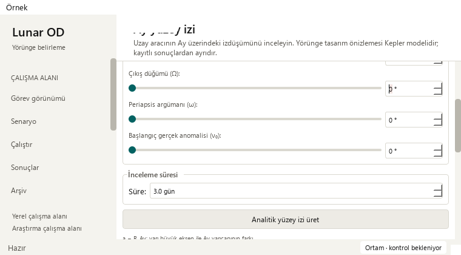
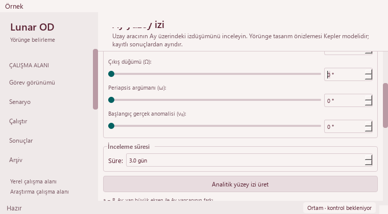

# Keep parameter names visible with keyboard focus — 2026-10-22

Base: `556c3fb76b597aa33bd35e0418cf655286fae571` (PR #43).
One usability issue: an input remained visible while its parameter name scrolled
partly out of view, particularly with Shift+Tab in a small window.

## Reproduced issue and correction

The strengthened existing traversal regression passes at 1480 × 1000 on the
base and fails at 910 × 465 and 760 × 420. The numerical controls fit, but the
associated inclination/node-angle labels are clipped above the viewport.
The native Modern probe reproduces four clipped-label observations, including
both a numeric input and its corresponding slider; all focused controls fit.


Expand the existing deferred keyboard reveal to include the visible label that
belongs to the focused control. A Designer slider uses the same label as its
paired numeric input. Qt buddy associations remain authoritative. Each ancestor
scroll viewport exposes the label and control together, keeping the existing
12-pixel margin. The existing focus guard and mouse behavior remain unchanged.
There is no new shortcut, focus order, visual theme or numeric input behavior.



## Preservation and verification

Only `GroundTrackController._reveal_keyboard_focus` changes in production.
**72 exact source segments** remain unchanged, including the entire Designer,
all module-level functions, the SPICE worker, calculations, element metadata,
input limits/steps/defaults, renderers, rejection guard, result installation,
playback and exports. Whole-module AST comparison confirms no other changes.
No scientific code, model, tolerance or recorded data is edited.

The three existing real-key traversal cases now require the complete associated
label and control rectangles inside every ancestor scroll viewport, with no
manual reveal and no pixel allowance. They still traverse all 14 controls in
both directions, edit the first slider, and retain the exact old result/figure/
canvas/playback position and exported CSV. No existing assertion was removed;
the public case count remains 387. Eight SPICE shortcut/busy/hidden-page cases
continue to pass.

Modern and Orchid each have 75 fresh focus observations across the three sizes:
**150 after-change observations with no clipped input or associated label**.
The 18 fresh layout/state captures cover both palettes at 1480 × 1000,
910 × 465 and 760 × 420, in initial, rejected-orbit and pending-SPICE states.
Controls remain reachable and there is no horizontal page scrolling.



Fresh circular and `e=0.05` analytical 0.1-day CSVs match the previously qualified
PR #43 reference byte-for-byte in both themes. Reference hashes are explicit in
the receipt; the previous outputs are used as stored references, not described
as newly generated before-change captures. The 361-sample SPICE example is
replayed through a controlled worker; its CSV SHA-256 remains
`f9f0f1a605f71bc6cbd3eecad291e1310b69a1316afc8a1c53fd943f7483bb0a`.
No new SPICE propagation or real spacecraft telemetry is claimed.

The saved solver output still loads 145 truth states, four stations and 12
measurement-sample windows in J2000. Madrid selection and synchronized playback
21600 → 25800 s work at wide/minimum Mission windows.
Observations remain synthetic, operational success remains 0/4, convergence
unknown. Eight legacy runs retain missing-data guidance; all 48 source-file
hashes match. These are UI/source-contract checks, not scientific accuracy proof.

## Validation and limits

| Gate | Result |
| --- | --- |
| Base, strengthened existing traversal oracle | 1 passed, 2 failed as expected |
| Focused Designer/ground-track suites | 65 passed; 63.91 s |
| Public isolated fixtures | 387 passed, no failures/errors/skips; 148.32 s |
| Full regression | 1,983 passed checks; 29 existing skips; 561.681 s |
| Native review | Both themes; wide/two small sizes; focused names and fields |
| Preservation | 72 exact segments; AST boundary; identical analytical/SPICE CSV |

Full JUnit records 2,012 checks: 1,866 named cases plus 146 unittest subchecks.
The 29 existing skips are 21 opt-in slow and eight unavailable external-data
checks; existing numerical/historical warnings remain visible. No campaign,
tooling dependency or new CI configuration is added. Times are validation
durations, not speed benchmarks.

```powershell
python -m pytest -p tests.desktop_preferences tests/test_orbit_designer_guidance.py tests/test_ground_track_keyboard.py tests/test_ground_track_layout.py tests/test_ground_track_workflow.py tests/test_ground_track_lifecycle.py tests/test_ground_track_results.py tests/test_ground_track_density.py tests/test_ground_track_models.py tests/test_ground_track_legibility.py -q
python tools/run_public_checks.py --junitxml=outputs/public.xml
python -m pytest -p tests.desktop_preferences tests -q -ra --junitxml=outputs/full.xml
python -m pip check
python tools/check_repository.py
git diff --check
```

Dependency and whitespace checks pass. Repository validation checks 597 migrated
paths, 409 preserved byte identities, 126 documents and 391 local links. The
ignored local dependency graph is refreshed without LLM labeling.

See the [sanitized receipt](orbit-designer-context-receipt_2026-10-22.json).
Required GitHub checks and Release qualification must pass before protected
merge; the exact merged-main SHA and downloaded JUnit get a separate local
hosted-CI receipt. No user-app restart, release tag or portable asset publication.

## Next work

- Header text still appears clipped in focus-traversal captures, while initial
  captures fit. The observed wide title rectangle remains 27 pixels high with
  a 26-pixel minimum hint/font height; explicit repaint did not clear the effect.
  Inspect actual paint/occlusion regions in a supported interactive environment
  before choosing a layout or rendering fix. This change does not claim to fix it.
- Existing offscreen modal-painting limitation remains; original dialogs are
  unchanged and not re-probed. Captures qualify offscreen Qt/Fusion only.
- Revisit large-archive performance when a measurable bottleneck is available.
