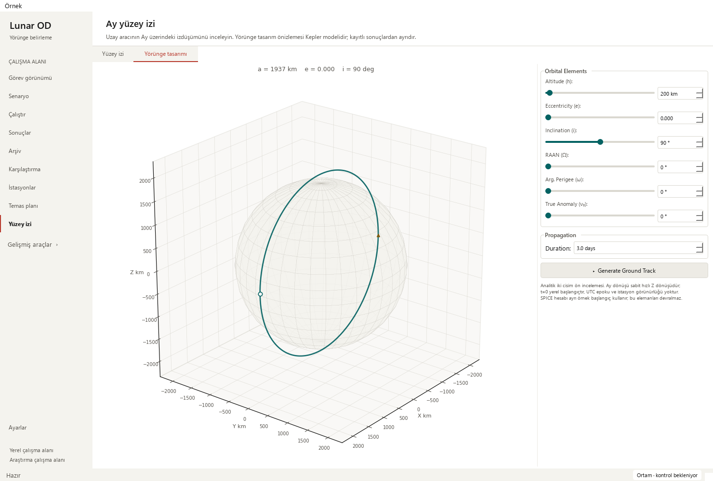
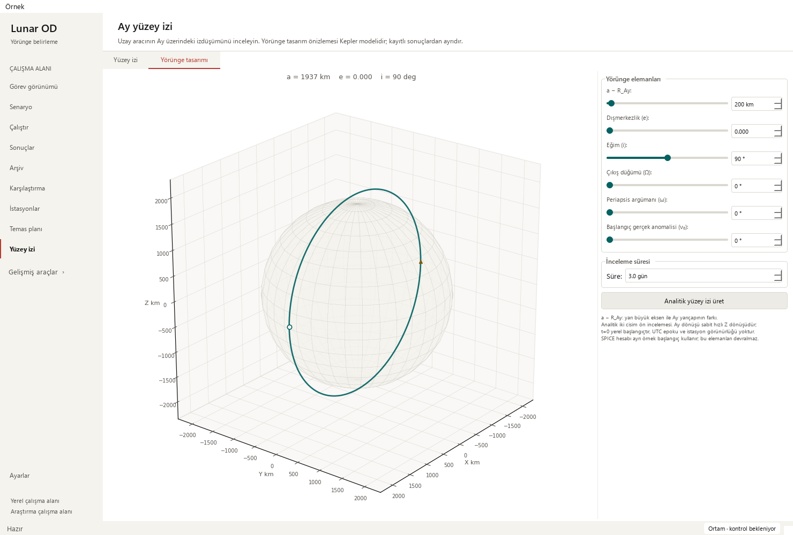
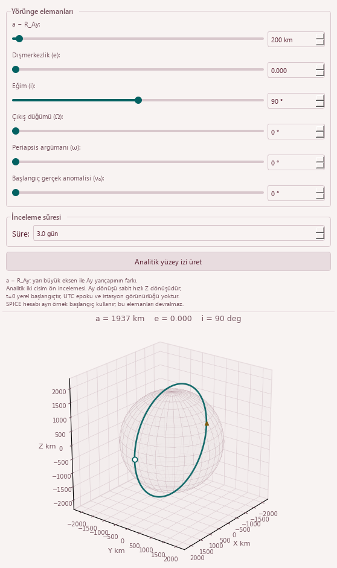

# Clear inputs in the analytical orbit designer — 2026-10-21

Base: `9a653277b001e7b88e52a9ee6dbe25e7b2176652` (PR #38).
Scope: analytical-designer form wording/help, field associations and result captions.

## Reproduced issues

- The form mixed English headings/actions with Turkish source notes. All six
  orbital inputs had empty accessible names/tooltips and no explicit label buddy.
  Both new wide/minimum-window cases failed at the first missing association.
- **Altitude (h)** did not identify the actual parameter. Existing propagation,
  preview geometry and metrics all use `a = R_MOON + alt_km`. The field is
  **a − R_Ay**, equal to surface altitude for a circular orbit, and not defined
  as instantaneous/periapsis altitude for an eccentric orbit. The result tooltip
  also used the ambiguous **Yükseklik (km)** label.





## Changes and preserved meaning

Use Turkish form headings, element names, duration suffix, Generate action and
analytical status text. The first field, inline explanation, hover help,
accessible name and result tooltip consistently identify **a − R_Ay**. Each
orbital input and slider has a name and short explanation; labels point to
their numeric field. Duration help retains the local `t=0`, with no UTC epoch.
The existing notes still separate the analytical two-body approximation,
constant-rate Moon rotation, absent station visibility and independent SPICE
example. Model/source declarations remain explicit.

Wrap element labels within their available width. An initial default-font wide
probe found a numeric field protruding beyond the viewport after translation;
wrapping fixes the form's minimum-width demand. The strict complete-widget
bounds oracle is retained. No palette, font-size, numerical range/default,
slider mapping, animation timing, calculation or result-installation change.

The Generate button has a stable object name. The existing workflow tests now
locate that button by identity instead of matching its old English text, and
still verify its enabled state and exact restored label after a pending request.
The existing analytical provenance assertion uses the corrected axis-offset
label; it continues checking retained captured elements and source isolation.



## Source and functional checks

**70 exact source segments** are preserved, including every module-level
function, the complete SPICE worker, the original analytical Generate/rejection
function, numerical helpers, renderers, playback and serializers. The whole
controller AST matches after masking display strings and removing only the new
help dictionary, naming/help/wrapping/buddy calls and their two local metadata
assignments. Config keys, units, limits, defaults, steps and decimals match the
base exactly. Only `_build`, `_refresh_result_context` and the analytical status
caption method changed. No scientific tolerance was edited.

Modern and Orchid each check initial, rejected-orbit and pending-SPICE states at
1480 × 1000, 910 × 465 and 760 × 420, before/after: **18 paired native layouts**.
Labels fit or wrap without clipping, controls remain reachable, and no horizontal
page scrolling appears. The paired screenshots fix only the camera angle for
comparison; the real visible preview timer is also checked. No new Designer
keyboard shortcut or whole-app accessibility qualification is claimed.

Circular and `e=0.05` analytical 0.1-day CSV outputs are byte-identical to the
base in both palettes. The two new behavioral cases precisely edit eccentricity,
retain the old export until explicit Generate, assert the actual original input
arguments, preserve uncomputed visibility/no UTC, and reject `e=0.5` without
propagation or loss of the displayed/exported result. Pending SPICE continues
blocking analytical Generate. This checks UI contracts, not scientific accuracy.

The prior 361-sample SPICE example is replayed through a controlled worker,
not propagated anew or described as telemetry. Export SHA-256 stays
`f9f0f1a605f71bc6cbd3eecad291e1310b69a1316afc8a1c53fd943f7483bb0a`.
The existing saved solver output still opens 145 truth states/four stations/12
measurement-sample windows, with Madrid selection and linked playback 21600 →
25800 s, including the minimum Mission window.
Observations remain synthetic, operational success 0/4 and convergence unknown.
Eight legacy runs retain missing-data guidance; all 48 source-file hashes match.

## Validation and limits

| Gate | Evidence |
| --- | --- |
| Base | Two new field-association workflow cases fail |
| Focused ground-track/designer suites | 62 passed; 51.919 s |
| Public isolated fixtures | 384 passed; zero failures/errors/skips; 121.873 s |
| Full local regression | 1,945 passed checks; 29 existing skips; 621.692 s |
| Native review | Both themes, wide/two narrow sizes, three states, saved/exported sources |
| Preservation | 70 exact segments, config/AST boundary, identical analytical/SPICE CSV |

Full JUnit records 1,974 checks: 1,828 named cases plus 146 unittest subchecks.
Skips are 21 opt-in slow and eight unavailable external-data checks; existing
numerical-reference/historical-reproduction warnings remain visible. Durations
are validation times, not speed benchmarks. No long campaign was added.

An **optional modal-painting probe is unavailable**: generic, unmodified
`QMessageBox.show/exec` probes exited with `0xC0000005` in this offscreen runtime,
with and without mocking or the non-native-dialog attribute. Dialog translations
were removed from this feature. The original Generate, rejection message and
guard remain byte-identical; the rejection call/message are checked with a mock.
Actual modal rendering is not qualified here. The panel/preview captures above
and all final behavioral gates pass; the generic probe result is retained in
the receipt rather than presented as successful visual coverage.

```powershell
python -m pytest -p tests.desktop_preferences tests/test_orbit_designer_guidance.py tests/test_ground_track_models.py tests/test_ground_track_workflow.py tests/test_ground_track_layout.py tests/test_ground_track_lifecycle.py tests/test_ground_track_keyboard.py tests/test_ground_track_results.py tests/test_ground_track_legibility.py tests/test_ground_track_density.py -q
python tools/run_public_checks.py --junitxml=outputs/public.xml
python -m pytest -p tests.desktop_preferences tests -q -ra --junitxml=outputs/full.xml
python -m pip check
python tools/check_repository.py
git diff --check
```

See the [sanitized receipt](orbit-designer-guidance-receipt_2026-10-21.json) for
hashes and observations. Dependencies, repository/links and whitespace checks
pass. Hosted strict Documentation, Public, Library, Dependencies and Release
qualification must pass before normal protected merge; merged-main CI gets a
separate local receipt. The local code graph is refreshed without LLM labels.

## Acceptance and next work

**Pass for the form's input meaning, wording and label associations.**
Small windows retain vertical scrolling. Existing native modal wording is
unchanged; portable assets and the running user's app are unchanged.

- Completed: analytical form explanations, explicit axis offset, field/slider
  naming and association, wrapped labels and consistent result captions.
- Next: review Designer keyboard focus visibility using the existing SPICE
  implementation as a reference, only if a concrete navigation issue reproduces.
- Later: qualify native modal rendering in a supported interactive environment
  before translating those dialogs; inspect archives for a demonstrated bottleneck.
