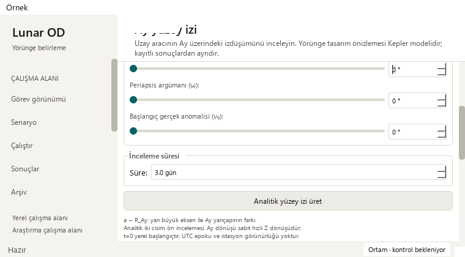
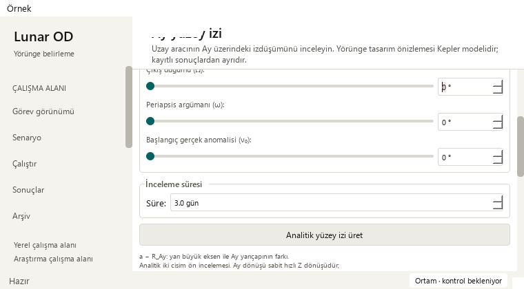
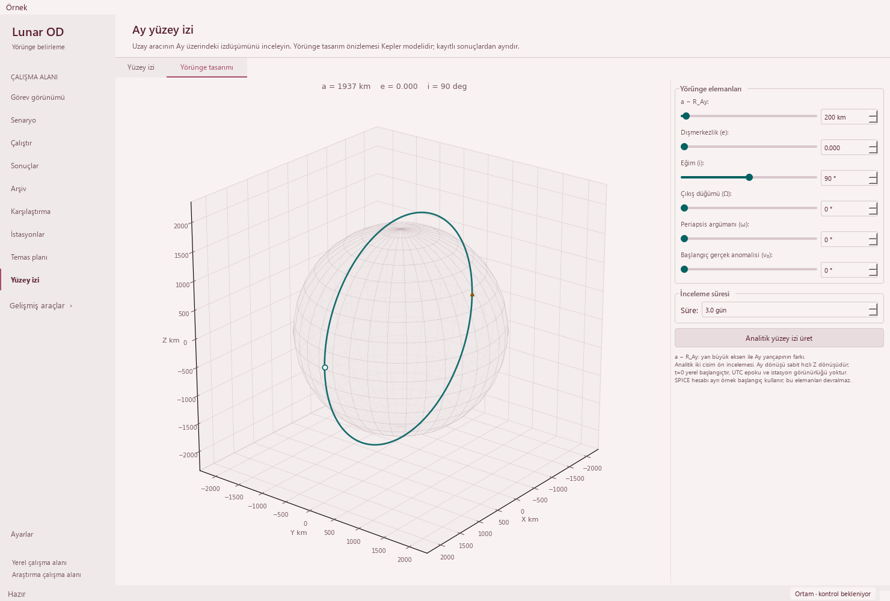

# Complete keyboard focus in the orbit designer — 2026-10-21

Base: `b3e6aa5997721b81268c0a9bd1b4599c3f333c4f` (PR #42, including others' merged research/physics work). One usability issue:
Tab/Shift+Tab could leave part of the focused input outside a scroll viewport.

## Reproduction and correction

The initial regression on `a5707e0` passes at 1480 × 1000, but fails at both
910 × 465 and 760 × 420. The controller and its Designer/layout/workflow fixtures
are byte-identical between that initial base and the updated base. A fresh fetch
found PRs #39/#41/#42; they were integrated intact, the superseded full run
was canceled, and final validation was rerun on the updated base. Real Qt key
events traverse the six sliders, six
numeric fields, duration and Generate in both directions. The oracle requires
the **entire control rectangle** inside every ancestor scroll viewport, with
no manually assisted scrolling and no pixel allowance. The base can clip
numeric fields by a few pixels; the Modern native probe also reproduces
top-edge clipping during reverse traversal.



Register the Designer controls with the existing deferred keyboard-focus filter.
After Qt finishes its default focus scrolling, expose the complete control in
each enclosing scroll area, from the inner form outward. Preserve the existing
SPICE controls' behavior. No new shortcut or focus order is introduced.
Mouse focus keeps its existing behavior; the handler still requires an actual
focused, registered control and a visible page.



## Preserved behavior and review

Only three existing controller methods change: focus registration in `_setup`
and `_add_orbit_designer_tab`, and ancestor scrolling in `_reveal_keyboard_focus`.
**70 exact source segments** remain unchanged. The entire `_OrbitDesigner`,
all module functions, SPICE worker, propagation/preview calculations, input
metadata/ranges/defaults/steps, source captions, rejection guard, result
installation, playback and exports are identical. A whole-module AST check
confirms no changes outside the three methods. No scientific tolerance changes.

Three behavioral cases traverse all 14 controls forward and backward, edit
the first slider with an arrow key, and retain the exact old result/figure/
canvas/playback position and CSV. Eight existing SPICE keyboard cases still
check shortcuts, precise edits, busy controls and hidden-page isolation.

Modern and Orchid captures review 1480 × 1000, 910 × 465 and 760 × 420,
with initial, rejected-orbit and pending-SPICE states: **18 paired layouts**.
Additional real-key probes show no clipped focused controls after the fix in
either palette. A 1480 × 420 short-wide probe also checks complete bounds in
both enclosing viewports, with no clipped controls; scrolling occurs in the
outer page at that size. Both local analytical 0.1-day CSV cases (`e=0`, `e=0.05`) match
the base byte-for-byte. A replay of the previously hashed 361-sample SPICE
example retains CSV SHA-256
`f9f0f1a605f71bc6cbd3eecad291e1310b69a1316afc8a1c53fd943f7483bb0a`.
No new SPICE propagation or real spacecraft telemetry is claimed.



The saved solver run still opens 145 truth states, four stations and 12
measurement-sample windows in J2000. Madrid selection and linked playback
21600 → 25800 s work, including the minimum Mission window.
Observations remain synthetic; operational success remains 0/4, convergence
unknown. Eight legacy runs retain missing-data guidance; all 48 source-file
hashes match. These checks protect UI/source contracts, not scientific accuracy.

## Validation

| Gate | Result |
| --- | --- |
| Base regression | 1 passed, 2 failed as expected |
| Targeted Designer/ground-track suites | 65 passed; 72.554 s |
| Public isolated fixtures | 387 passed; no failures/errors/skips; 173.64 s |
| Full regression | 1,983 passed checks; 29 existing skips; 620.484 s |
| Native Qt review | Both themes; wide/two small sizes; complete control bounds |
| Preservation | Exact source/AST scope; identical analytical/SPICE CSV |

Full JUnit contains 2,012 checks: 1,866 named cases plus 146 unittest subchecks.
Existing skips are 21 opt-in slow and eight unavailable external-data checks.
Existing numerical/historical warnings remain visible. No new campaign or
tooling dependency; durations are validation times, not speed benchmarks.

```powershell
python -m pytest -p tests.desktop_preferences tests/test_orbit_designer_guidance.py tests/test_ground_track_keyboard.py tests/test_ground_track_layout.py tests/test_ground_track_workflow.py tests/test_ground_track_lifecycle.py tests/test_ground_track_results.py tests/test_ground_track_density.py tests/test_ground_track_models.py tests/test_ground_track_legibility.py -q
python tools/run_public_checks.py --junitxml=outputs/public.xml
python -m pytest -p tests.desktop_preferences tests -q -ra --junitxml=outputs/full.xml
python -m pip check
python tools/check_repository.py
git diff --check
```

Dependency consistency and whitespace checks pass. Repository validation checks
597 migrated paths, 409 preserved byte identities, 125 documents and 386 local
links. The ignored local dependency graph is refreshed without LLM labeling.

See the [sanitized receipt](orbit-designer-keyboard-receipt_2026-10-21.json).
Hosted Public, Documentation, Library, Dependencies and Release qualification
must pass before normal protected merge. The merged-main SHA and downloaded
JUnit receive a separate local hosted-CI receipt.

## Limits and next work

- Captures use actual Qt widgets in offscreen Fusion, not an interactive Windows
  qualification. The earlier generic modal-painting limitation is not re-probed;
  original dialogs and their existing mock-based guard checks are unchanged.
- Investigate heading clipping seen in focus-traversal captures (initial captures
  fit); distinguish a repaint artifact from a layout issue before changing code.
  Also check whether an input's label should stay visible above it.
- Revisit large-archive performance only when a measurable bottleneck is available.
- No user-app restart, portable release asset or release tag in this change.
