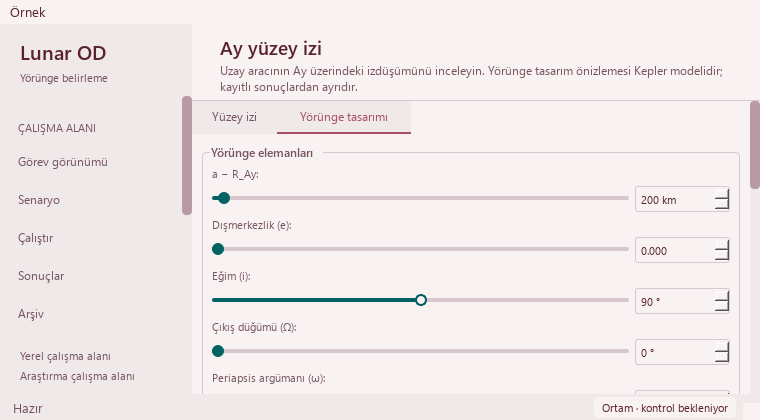

# Visible keyboard focus on orbit-design sliders — 2026-10-22

Base: `d24e380ce0eae1673ec1ded6a6b68fac3f69ba58` (PR #46). Others' merged physics/research work is preserved.
One UI issue: all six analytical Designer sliders looked identical with and without keyboard focus.

## Evidence and change

Real Tab/Shift+Tab events give each slider focus. The native Modern and Orchid
probes confirm `hasFocus()` yet **zero changed pixels** for all six sliders:
12 missing visual focus cues on the initial PR #44 base. The latest main was
then integrated intact; final test gates run on PR #46. UI source, application
services and existing native references are unchanged across that integration.
Numeric inputs already show their editing state and Generate has a native focus treatment, so their styling is retained.

Before, focused inclination slider:


Use a hollow handle while focused, with the existing surface and accent tokens.
The normal handle stays filled. A 2-pixel border and 8-pixel content dimensions
retain the existing **12 × 12 logical-pixel handle rectangle**. The cue changes
shape as well as fill and uses no new palette color or animation.


Exactly **two stylesheet lines** are added in `_OrbitDesigner._build`.
Removing those two lines makes the entire controller source identical to the
base. All **72 other source segments**, callbacks, ranges/defaults/steps,
slider-value mapping, focus scrolling, labels, calculations, renderers, playback,
result installation and serializers remain exact. No physics, tolerance or
recorded data is edited. The UI patch changes no call structure or dependency.
The ignored local graph is refreshed for the integrated upstream module changes,
without LLM labeling.

## Native and functional checks

Modern/Orchid at 1480 × 1000 and 760 × 420 give **24 focused-slider observations**.
Each shows changed rendering with the same handle rectangle and unchanged value.
The controls and associated names fit their ancestor scroll viewports. All 12
wide, unfocused slider rasters are identical to the base; only focus paint changes.
This is direct visual/geometry QA, not a test that mirrors the stylesheet text.
No new unit case is added for the small style adjustment.



The existing 65 targeted cases still check keyboard editing, label/context reach,
busy/hidden-page behavior, atomic result installation, preview lifecycle, narrow
layouts, model/source labels and retained exports. The public case count stays
387. A controlled same-window probe, with the preview timer stopped, sees
zero canvas redraws for baseline/candidate/baseline keyboard traversals; it does
not benchmark active preview animation. Eighteen fresh state/layout captures
cover both palettes at 1480 × 1000,
910 × 465 and 760 × 420, in initial, rejected-orbit and pending-SPICE states.

Fresh circular and `e=0.05` analytical 0.1-day CSVs match the qualified PR #44
reference byte-for-byte in both themes. The prior 361-sample SPICE example is
replayed through a controlled worker and retains CSV SHA-256
`f9f0f1a605f71bc6cbd3eecad291e1310b69a1316afc8a1c53fd943f7483bb0a`.
The references are stored earlier outputs, not newly captured base runs.
No new SPICE propagation or real spacecraft telemetry is claimed.

The existing saved solver output loads 145 truth states/four stations/12
measurement-sample windows in J2000. Madrid selection and linked playback
21600 → 25800 s work at wide/minimum Mission windows.
Observations remain synthetic, operational success 0/4, convergence unknown.
Eight legacy runs preserve missing-data guidance and all 48 source-file hashes.
These protect UI/source contracts and do not prove scientific accuracy.

## Header investigation: manual-pump artifact

The earlier clipped-title captures were traced to the retired Qt Designer
`QStackedWidget`: `deleteLater()` was pending while the manual event pump only
called `processEvents()`. Hit testing found that obsolete widget over the top
of the title. Delivering `QEvent.DeferredDelete` with
`QCoreApplication.sendPostedEvents` removes it, and hit testing returns
`pageTitleLabel` throughout the title. The title geometry stays identical at
wide and minimum sizes, before and after keyboard traversal.

Visual probes now deliver deferred deletions before capture, matching normal
Qt event-loop cleanup. The title renders fully in the reviewed captures.
No production header/font/layout change is made. This resolves the earlier
capture limitation without treating it as a proven font-size defect.

## Validation

| Gate | Result |
| --- | --- |
| Base native focus probe | 12 focused sliders, zero paint change |
| Updated native focus probe | 24 visible cues; stable geometry and values |
| Existing targeted suites | 65 passed; 153.395 s |
| Public isolated fixtures | 387 passed, no failures/errors/skips; 282.521 s |
| Full regression | 2,001 passed checks; 29 existing skips; 937.95 s |
| Source preservation | Entire controller matches after removing two style lines |

Full JUnit contains 2,030 checks: 1,884 named cases plus 146 unittest subchecks.
Existing skips remain 21 opt-in slow and eight unavailable external-data checks.
Existing numerical/historical warnings stay visible. Times are validation
durations, not speed benchmarks. No long scientific campaign or new dependency.

```powershell
python -m pytest -p tests.desktop_preferences tests/test_orbit_designer_guidance.py tests/test_ground_track_keyboard.py tests/test_ground_track_layout.py tests/test_ground_track_workflow.py tests/test_ground_track_lifecycle.py tests/test_ground_track_results.py tests/test_ground_track_density.py tests/test_ground_track_models.py tests/test_ground_track_legibility.py -q
python tools/run_public_checks.py --junitxml=outputs/public.xml
python -m pytest -p tests.desktop_preferences tests -q -ra --junitxml=outputs/full.xml
python -m pip check
python tools/check_repository.py
git diff --check
```

Dependency and whitespace checks pass. Repository validation checks 597 migrated
paths, 409 preserved byte identities, 130 documents and 396 local links.

See the [sanitized receipt](orbit-slider-focus-receipt_2026-10-22.json).
Required GitHub checks and Release qualification must pass before protected
merge. Exact merged-main CI and downloaded JUnit receive a separate local receipt.

## Next work and limits

- Keep deferred-delete delivery in manual capture loops; do not patch production
  layout to compensate for a pending retired widget in a QA harness.
- Measure active preview frame cost and event-loop responsiveness before
  adding animation changes; the stopped-preview probe does not qualify that cost.
- Review other keyboard focus states only if a new visual probe demonstrates
  a missing cue. No blanket retheme or extra control is warranted.
- Offscreen Qt/Fusion does not qualify all interactive Windows/high-DPI behavior.
  The existing modal-painting limitation remains; original dialogs are unchanged.
- Revisit archive performance when a measurable bottleneck is available. No user
  app restart, portable release asset publication or release tag in this change.
