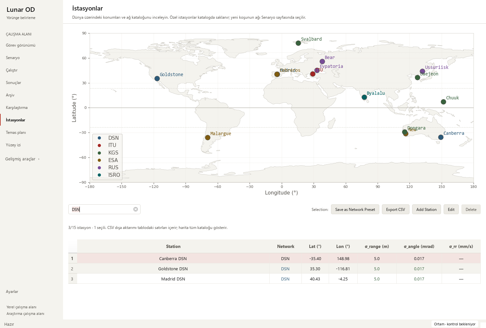
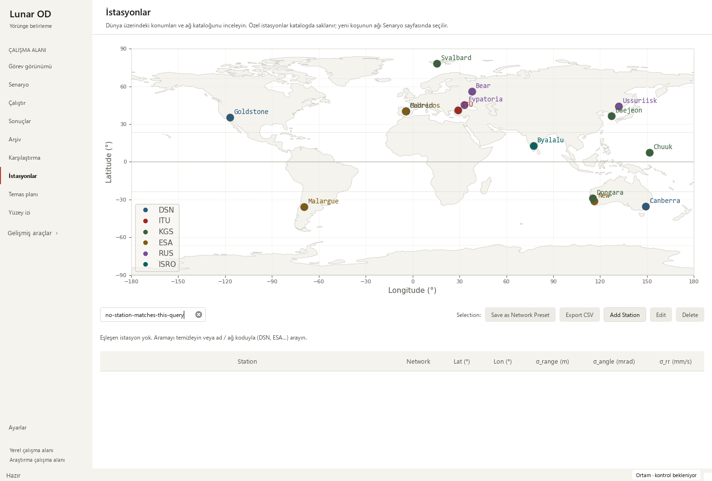

# Station catalogue search and export — 2026-10-13

Base: 743a34e7fed8a3296e861c8751372e64837e1793. This bounded iteration changes
catalogue search feedback and CSV scope in `StationsController`. Scientific
calculations, station configuration/persistence and recorded-run geometry are
unchanged.

## Observed problems and changes

The former export fallback used the full catalogue whenever the filtered list
was empty. A zero-match search could therefore export 15 hidden entries despite
the button's displayed-stations description. A blank table gave no recovery
instruction or visible/total count; search also lacked a clear action and find
shortcut.

- CSV export now uses only filtered rows. Zero matches disable the button and
  return before the file dialog, including direct method calls.
- A plain status line shows visible/total and selected counts. It explains that
  CSV includes the whole filtered table, while the map shows the full catalogue.
  No-match searches and an empty catalogue have different recovery guidance.
- Ctrl+F from the table focuses/selects the query. A native clear button restores
  all rows. The search has a descriptive accessible name and tooltip.
- Toolbar/status sizing avoids surplus vertical space. The wrapped status line
  fits a small viewport; the existing station page still requires horizontal
  and vertical scrolling in small windows. Compact reflow is future work.

## Verification

    python -m pytest -p tests.desktop_preferences tests/test_station_catalog_filters.py tests/test_mission_overview.py tests/test_tracking_render_semantics.py tests/test_large_workspace.py -q
    python tools/run_public_checks.py --junitxml outputs/public-checks.xml
    python -m pytest -p tests.desktop_preferences tests -q -ra --junitxml outputs/full.xml

The final targeted set passed **48 checks**. Four new cases verify empty-filter
export blocking, the exact three DSN names and unchanged raw coordinate/noise
units, selection-independent CSV scope, Ctrl+F/query clearing and distinct
empty-catalogue guidance. Fixtures isolate QSettings and skip the unrelated
Matplotlib map; native checks use the actual map.

The isolated public gate passed **275 cases**, zero failures/errors/skips,
in 35.196 seconds. The full local regression passed
**1,803 checks**, with **29 existing skips**, zero failures/errors, in
303.691 seconds. JUnit records 1,832 checks: 1,686 named cases
and 146 subtest checks. Scientific assertions, tolerances and optional slow/data
skip policies were retained.

Local JUnit SHA-256 receipts:

| Receipt | SHA-256 |
| --- | --- |
| Targeted | `F78E3D5A59F133E5A1C45B236B4473CD577F5094E1BC8730415C255C15585B43` |
| Public | `C4B45E0FA6A927768A5B3F198B3EB4C5FDAAA9B53019CB94E76662265CA8B86C` |
| Full | `2201EB72C279C1092C6FABA2F7CB6FBBC8FC0CA1F3E4523C821C6D8CAB6E35A7` |

Native Windows Qt review covered 1480×1000, 910×465 and 760×420 in Modern at
display scale 1 and Orchid at scale 2. Search, selection, exact DSN export,
Ctrl+F, empty results and clearing passed. Each action and the status text could
be brought fully into the small viewport using the available scrollbars. The
actual Matplotlib map remained present; station-config SHA-256 was unchanged.
The screenshots also retain known crowded map labels; this iteration does not
claim to fix that separate catalogue map.

The existing 24-hour solver output reopened with 145 saved truth states,
four stations and 12 measurement-sample windows. Selection/playback and both
small Mission layouts passed. Observations are synthetic; all four recorded
arc-success flags remain false. Eight legacy runs reopened, retained explicit
missing geometry/measurement-time messages and all 48 source hashes. See the
[sanitized receipt](station-filters-receipt_2026-10-13.json).

## Interpretation and remaining design work

**Pass with caveats:** safe to merge this catalogue fix after the documented
local gates. Impacted metrics are visible/exported station counts and UI
accessibility; no numerical baseline drift is expected. Existing CSV raw units
are preserved (radians and m/s, although the table displays mrad and mm/s).
No new scientific campaign, long real telemetry acceptance or convergence
qualification was run. No new tooling configuration or dependencies were added.
Graphify's ignored dependency graph was refreshed after adding the shortcut.

- Make the separate catalogue map/table/toolbar reflow at small widths and
  improve crowded labels; retain all edit/network/export actions.
- Review visibility and surface-track tools for short help, units and keyboard access.
- Profile representative large saved runs when available.
