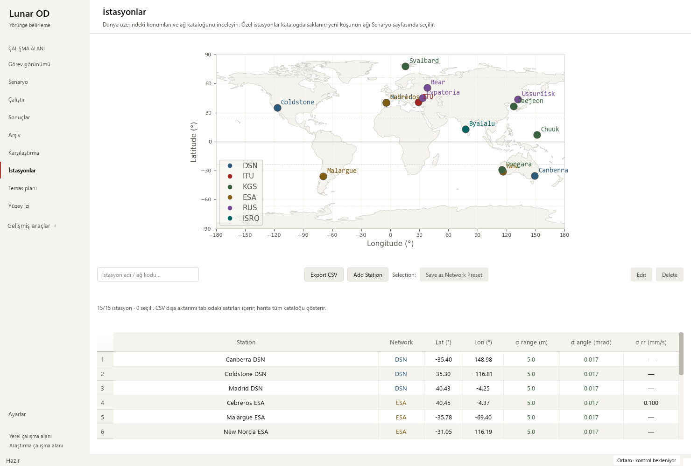
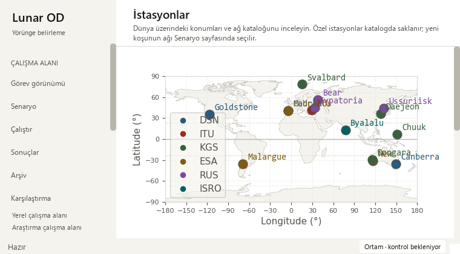
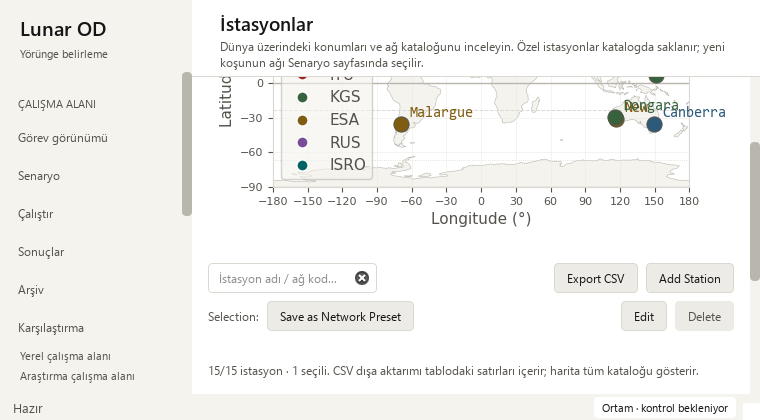

# Station catalogue layout — 2026-10-15

Base: f27db9da3c58aef413737bd4da5be14dcd8a7e15 (upstream PR #9). The 15 upstream
commits were fast-forwarded without conflicts before the final gates;
this UI change adds no modifications to those files. This iteration completes the
previous station-search report's narrow-window task. It changes native catalogue
layout and map sizing, preserving scientific code, station coordinates, CSV
fields, settings persistence and recorded-run data.

## Observed problems and changes

The application forced the station page to a 960-pixel minimum width. Its single
toolbar also required search and five actions to fit in one row. At 760×420,
users had to pan the whole page sideways to reach controls or see the full map.
The catalogue map scaled longitude and latitude independently.

- The station page now uses the same 540-pixel minimum content width as Mission.
  Other scientific forms keep their existing scrolling policy.
- Catalogue actions (search/CSV/add) and selection actions (network preset,
  edit/delete) remain visible. When their measured minimum widths cannot fit
  side by side, they stack into two rows; no overflow menu hides an action.
- Map height follows the available width, bounded to 240–440 logical pixels.
  Equal angular spans use equal pixel scales, fitting a 2:1 world rectangle.
  This equirectangular map does not preserve terrestrial distances or areas.
- Resizing reuses the existing canvas and keeps the query, station selection,
  all seven table columns, raw data and action enable/disable rules.

The page still scrolls vertically. The table has its own horizontal scrollbar
for coordinate/noise columns in a narrow window and its own vertical scrollbar
for remaining station rows. This is not a claim that every plot, action and
column is simultaneously visible in a 760×420 window.

## Verification

    python -m pytest -p tests.desktop_preferences tests/test_station_catalog_filters.py tests/test_mission_overview.py tests/test_workspace_appearance.py -q
    python tools/run_public_checks.py --junitxml outputs/public-checks.xml
    python -m pytest -p tests.desktop_preferences tests -q -ra --junitxml outputs/full.xml

The final targeted gate passed **45 checks**. Four new parameterized cases check
760×420 and 910×465 resizing, wide/narrow round trips, absence of horizontal page
scrolling, toolbar containment, exact retained table values/selection/filter,
all seven columns and the separate scrolling policy on Scenario. Actual
Matplotlib renders at 520×300 and 1120×440 verify equal degree-to-pixel scales,
full world limits and exact original coordinates for every station marker.
The pixel assertion tolerance is 1e-8 pixels; no scientific tolerance changed.

The isolated public gate passed **279 cases**, zero failures/errors/skips, in
36.741 seconds. The full local regression passed **1,840
checks**, with **29 skips**, zero failures/errors, in
482.450 seconds. JUnit records 1,869 checks: 1,723 named cases
and 146 subtest checks. All eight station cases are included in the public gate.

| Local JUnit receipt | SHA-256 |
| --- | --- |
| Targeted | `932CFA1085AE8FF7A5BEAFF8473C12C126C13C5CF505F6D4A325898AEB742E70` |
| Public | `77CAEBD9A2B451D58A4189EAA28D0F8586EE82B61A845B831FA726EE1E816803` |
| Full | `17A046E0486C63500B3656861938B3A2BFD8A02174A03B800CDFBC832043A73F` |

Native Windows Qt review passed in Modern at display scale 1 and Orchid at 2,
at 1480×1000, 910×465 and 760×420. The page's horizontal-scroll maximum was zero
at both narrow sizes. All actions/status text and the full table widget were
reachable by vertical scrolling; the map retained its canvas. An actual pointer
click on Canberra selected its exact table row and cleared the table filter.
CSV still contained precisely the three DSN stations. Station-config hashes
remained unchanged. Screenshots were inspected at wide and small sizes.

The existing verified 24-hour solver output reopened with 145 saved truth states,
four stations and 12 measurement-sample windows; playback/selection and both
small Mission layouts passed. Observations are synthetic and all four recorded
arc-success flags remain false. Eight legacy runs reopened, retaining missing
geometry/measurement-time guidance and all 48 source hashes. The
[sanitized receipt](station-layout-receipt_2026-10-15.json) records these checks.

## Interpretation and remaining design work

**Pass with caveats:** mergeable after the documented gates. Impacted metrics are
horizontal page-scroll range, action containment, retained row identities and
map proportions. No numerical baseline drift is expected. The interrupted
October 13 validation did not produce a full-suite receipt; final local and
native gates were completed again on October 15. No new scientific campaign,
long real telemetry acceptance, dependencies or tooling configuration were added.
The ignored Graphify graph was refreshed for the changed resize call structure.

- Resolve crowded catalogue map names/legend overlap while retaining every
  station and exact table selection; the separate Mission map already has
  bounded labels.
- Review visibility and surface-track tools for short help, units and keyboard use.
- Profile representative large saved runs when available.
