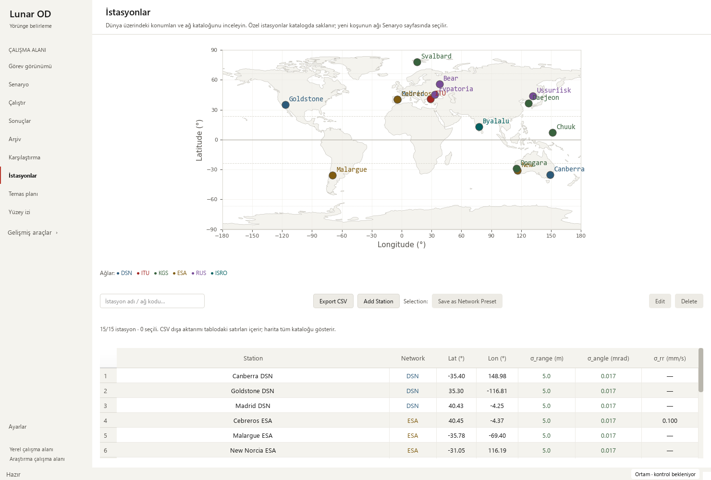
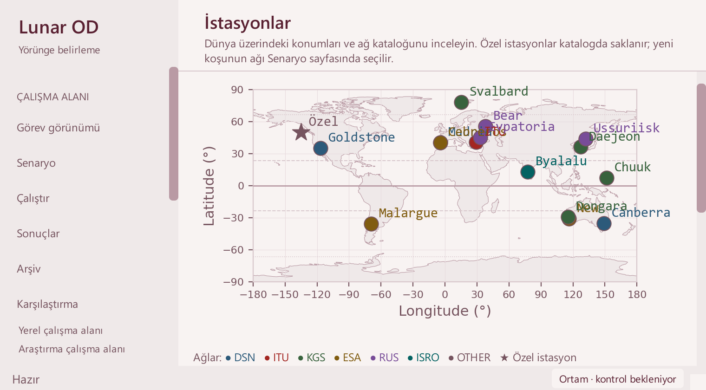

# Station catalogue map key — 2026-10-15

Base: 35225db62239fa86117487f5d7ca9ddb76db0dc8, after the repository layout
migration. Scope: `StationsController` map key and its display tests. Physics,
station coordinates, noise units, saved geometry and CSV fields are unchanged.

## Observed issue and changes

The six-row network legend occupied the lower-left geographic area. At small
widths it covered Goldstone and part of North America, obscuring station choice.
Its custom-star sample was yellow even when the actual custom marker used its
network color; unknown network codes had no individual legend entry.

- Remove the overlaid Matplotlib legend. Keep all original station markers and
  the equal longitude/latitude degree scales.
- Add a compact wrapping **Ağlar** row below the canvas. Its colors match the
  full map catalogue even when the table is filtered.
- Separate the **★ Özel istasyon** shape explanation from network colors.
  Include unknown network codes using the same fallback color as their markers.
- Refresh the key after successful map rebuilding; hide it for an empty catalogue.
  Escape network text and expose a plain explanation through Qt accessibility.

The custom station in the second screenshot was created only in the test
controller and removed afterward. It was not saved to the catalogue or user
settings. Crowded names in Europe/Australia remain a separate task; this change
removes legend occlusion, not all station-name collisions.

## Verification

    python -m pip install -e . --no-deps
    python -m pytest -p tests.desktop_preferences tests/test_station_catalog_filters.py tests/test_mission_overview.py tests/test_workspace_appearance.py -q
    python tools/run_public_checks.py --junitxml outputs/public-checks.xml
    python -m pytest -p tests.desktop_preferences tests -q -ra --junitxml outputs/full.xml

The required editable installation was restored in the existing validated
environment after the src migration. Runtime dependency pins were not changed;
build dependencies used pip's isolated build environment.

Targeted: **46 passed**. A new case covers full-catalogue key scope while
filtering, custom/unknown network semantics, escaped text and the empty state.
The two actual Matplotlib projection cases also assert the absence of an
in-map legend while retaining every exact station coordinate and world limits.

Public gate: **291 passed**, zero failures/errors/skips, in
40.038 seconds. Full local suite: **1,852 passed checks**,
**29 skipped**, zero failures/errors, in 495.007 seconds.
JUnit records 1,881 checks (1,735 named cases and
146 subtest checks). The suite's skip policies and numerical tolerances
were retained; this UI gate does not qualify estimator convergence.

| Local JUnit | SHA-256 |
| --- | --- |
| Targeted | `44D60D1F70444CF082A81E578E3E1626249D99E257F6341F9155803414F10C85` |
| Public | `839C0AD66AB2F1D1DF144F23A404CFFF79ADA707A1DE72B6084AFC122398823C` |
| Full | `80E8D3F0D76D8B33341CCDC0FD205317DFE09FD51E1C5E4DA420B94EF918D278` |

Native Qt review passed in Modern/display scale 1 and Orchid/scale 2, at
1480×1000, 910×465 and 760×420. The key was below the canvas at both small sizes,
with no horizontal page scrolling. Native pointer selection still chose Canberra;
DSN export contained exactly three stations. A temporary OTHER/custom station
updated both map and key and was then removed. All seven columns and actions
remained accessible; the station-config source hash was unchanged.

The existing verified 24-hour solver output reopened with 145 truth states,
four stations and 12 measurement-sample windows. Its observations are synthetic;
all four recorded arc-success flags remain false. Playback/selection and both
small Mission layouts passed. Eight legacy runs retained missing-data guidance
and all 48 source hashes. See the
[sanitized receipt](station-legend-receipt_2026-10-15.json).

## Interpretation and next work

**Pass with caveats:** software-safe to merge after these gates. Impacted metrics
are legend/plot separation and accurate shape/color keys. No numerical baseline
drift is expected. No new scientific campaign or real telemetry acceptance was
run. No dependency profile or tooling configuration was added. The ignored
Graphify dependency graph was refreshed for the new helper call structure.

- Resolve crowded catalogue station names without losing exact table selection.
- Review visibility and surface-track tools for help, units and keyboard use.
- Profile representative large saved runs when available.
