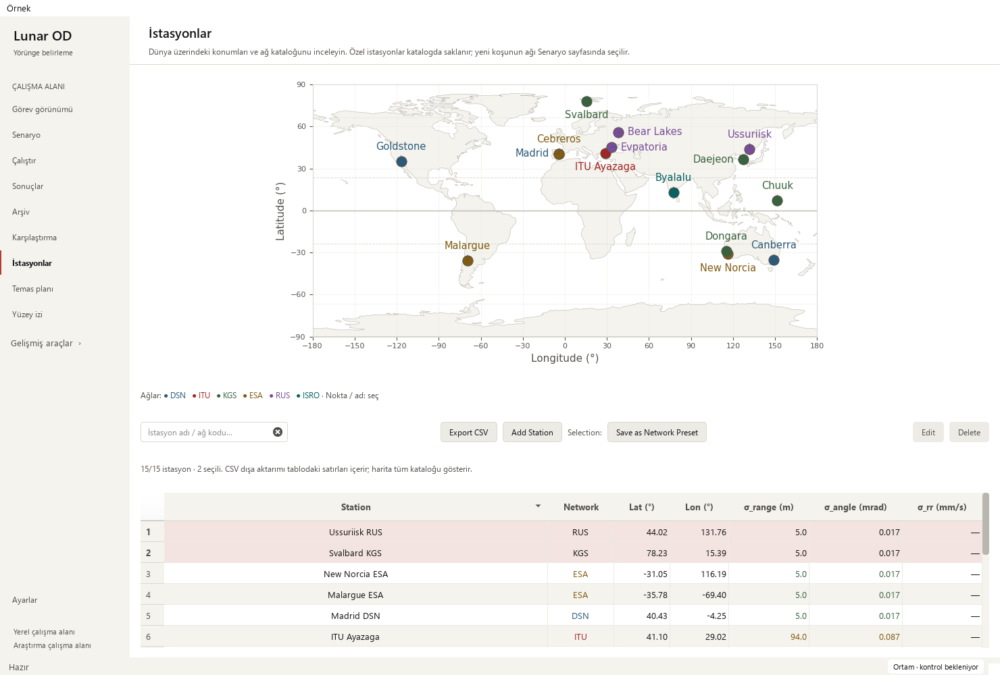

# Catalogue map labels and exact name selection — 2026-10-16

Base: `b842764be1d462d050c5fb63d89ed40c68034c0f` (PR #26).
Changed area: catalogue-only annotation layout/picking in `StationsController`
and `widgets/catalogue_map_labels.py`. The Mission map, Gantt, recorded playback,
station JSON and scientific implementation remain unchanged.

## Reproduced issue

The exact committed base had **three overlapping name pairs** and one name
outside the map on a 1120×440 native Qt canvas. At 520×300 it had **ten overlapping
pairs** and five names outside the map. Madrid/Cebreros and New Norcia/Dongara
were affected. Multiword cities were truncated to the first word. Three new
checks failed against that behavior before the implementation change.

The same original catalogue now has **15 visible names, zero overlapping name
pairs and zero names outside the map** at both canvas sizes. The
[sanitized receipt](station-map-labels-receipt_2026-10-16.json) records actual
before/after names and redraw measurements.

## Design and implementation

- Place text using the final renderer's actual font extents and map bounds.
  Reserve edge stations first, then choose a nearby free position from a bounded,
  deterministic candidate set. Avoid every station marker as well as earlier text.
- A lightweight Artist performs layout before annotation drawing in the same
  frame. Resize/DPI changes use the current transform; no follow-up draw timer,
  canvas rebuild or coordinate jitter is needed.
- Use readable sans serif city names including New Norcia, Bear Lakes and ITU
  Ayazaga. Network colors and the separate key are retained. Thin leaders connect
  displaced names to their original markers; they are annotation guides, not links
  between stations or visibility geometry.
- Names carry the full source identity and can be clicked. Cebreros ESA and
  Madrid DSN can be selected separately despite nearly coincident world-map dots.
  Pick only text rectangles; leader lines cannot intercept a marker click.
- Arbitrarily dense/oversized custom names may hide when no free position exists.
  Every marker and full table record stays available. The short key instruction
  and accessible help explain selection and the optional-name fallback. Names
  render literally, including dollar signs and angle brackets.

## Test plan and verification

Software risk: label overlap/overflow, first-frame/resize placement, pointer
identity and dense custom catalogues. Scientific coordinates, projection scale,
source units, tolerances, persistence and existing results are unchanged. Test
oracles are measured renderer rectangles, exact source name/coordinate pairs and
actual Qt pointer selection; no new numerical tolerance, random seed or baseline.

Four new cases cover both map sizes, deterministic repeated draw/resize, every
original marker center remaining clear, text-only hit areas, exact name selection
through a sorted filter, and a dense/edge custom catalogue with literal names.
Existing station coordinate/projection, numeric sort, CSV, preset and Mission
checks remain active.

    python -m pytest -p tests.desktop_preferences tests/test_station_catalog_filters.py tests/test_mission_overview.py tests/test_workspace_appearance.py -q
    python tools/run_public_checks.py --junitxml outputs/public-checks.xml
    python -m pytest -p tests.desktop_preferences tests -q -ra --junitxml outputs/full.xml

Targeted: **59 passed**. Public: **310 passed**, zero failures/errors/skips,
57.216 seconds. Full local suite: **1,871 passed checks**,
**29 existing skips**, zero failures/errors,
472.044 seconds. JUnit includes 1,900 checks:
1,754 named cases and 146 subtest checks. All 22 station
cases and all 35 mission cases are in the public gate.

| Local JUnit | SHA-256 |
| --- | --- |
| Targeted | `4ff03086e7ca47f97e94f780bb2864eb801876041f58580bb279e733dc56c84f` |
| Public | `439d968321037b38ef96f6b148dc256df02571ac5614d14981cff7346932e771` |
| Full | `d0186c22241738680f83b367875befeb874c5ee5ae876ee1c49b2647496e69f0` |

Native Qt offscreen review passed in Modern (scale 1) and Orchid (scale 2), at
1480×1000, 910×465 and 760×420. Actual Cebreros/Madrid label clicks selected the
exact table records through a filtered numeric sort. All 15 original names stayed
inside the map without overlap on native resize checks. Existing Canberra marker
click, keyboard find, empty-state guard, DSN CSV, preset contents, custom deletion
cancellation, seven columns and small-window controls passed. Source hashes stayed
unchanged. Reviewed wide and narrow native PNGs in both themes.

Three warmed redraw samples per canvas measured median totals of approximately
65→82 ms at 1120×440 and 86→95 ms at 520×300 in the reproduction environment.
This bounded static-map check documents added layout cost; it is not a playback
or large-run performance benchmark. No continuous rendering loop was introduced.

The existing 24-hour solver output reopened: 145 truth states, four stations,
12 measurement-sample windows, J2000. Observations are synthetic; all four
recorded arc-success flags remain false and convergence remains unverified.
Playback and both small Mission layouts passed. Eight legacy runs retained
missing-data explanations and all 48 source hashes. No new scientific campaign
or real telemetry acceptance was run.

`pip check`, repository migration/byte-identity/link checks and diff whitespace
checks passed. The ignored Graphify graph was refreshed for the new widget module.
Strict docs/library/release checks must pass on the PR. Local strict docs were
not run because MkDocs is absent from the validated scientific environment.
No dependency, workflow or tooling configuration was changed.

## Interpretation and next work

**Pass with caveats:** ready for the existing PR gates. Impacted metrics are label
rectangles, source identity, first-frame/resize behavior and pointer targets.
No numerical baseline drift is expected. Dense arbitrary names may hide as
explained in the key help; markers and table access remain intact.

- Catalogue label collision/overflow and name picking: complete.
- Next: visibility/surface-track tool explanations, empty states and keyboard flow.
- Profile larger saved-run workflows when representative source data is available.
