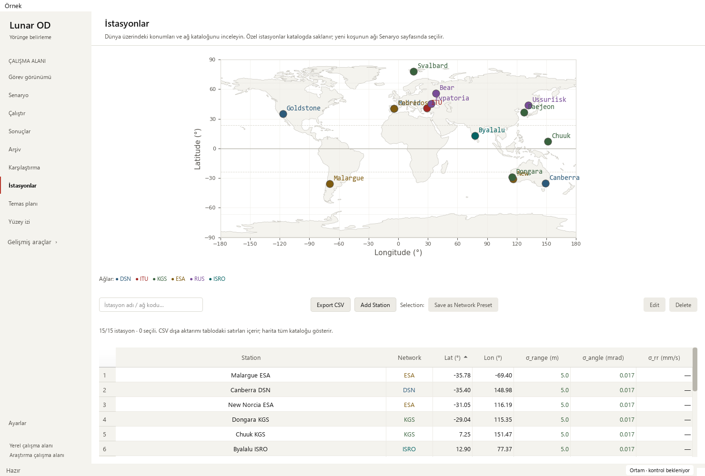

# Station catalogue numeric ordering — 2026-10-16

Base: `89ce0423ce44b04f02f505cec6fdb03c99a2edc3` (PR #25).
Changed area: `StationsController` numeric table items and their sort/help behavior.
The preceding [row-identity fix](station-sorting_2026-10-16.md) remains intact.

## Reproduction and design

Clicking the latitude header previously produced an ascending order beginning
**12.90°, −29.04°, −31.05°, 35.30°**, even though the catalogue contains −35.78°.
Qt compared the formatted cell strings. Longitude and all three uncertainty
columns used the same string comparison. The committed-base reproduction and
five new tests failed before the fix; the
[sanitized receipt](station-numeric-sort-receipt_2026-10-16.json) contains the
actual before/after 15-station latitude lists.

- Numeric items now compare their full stored numeric values, retaining the
  existing displayed decimal places, signs, units and colors.
- Right-align numeric values for scanning; keep name/network text behavior.
  Cell tooltips expose the underlying displayed-unit value at Python's numeric
  representation precision. Header help explains sorting and missing data.
- **— means undefined**, distinct from zero. Undefined entries follow all numbers
  in ascending order and precede them when that order is reversed.
- Sorting changes the view only. Filter rebuilds retain the chosen sort and clear
  stale selection. Edit/delete/map/preset actions retain source identity.
  CSV retains filtered source order, full source values and original units.

## Test plan and evidence

Software risk: table order, row identity and interpretation of missing values.
Scientific implementation, station JSON, measurement definitions, tolerances,
persistence formats and stored-result artifacts are unchanged. No estimator or
force-model numerical drift is expected; no scientific acceptance claim is made.

Five deterministic cases use hand-ordered temporary rows for latitude, longitude,
range uncertainty, angular uncertainty and range-rate uncertainty. They cover
negative coordinates, zero, 2 versus 10, rounded-equal but distinct precision,
and absent values; both directions, filter/clear retention, selected Edit target,
and actual CSV values/source order. These are UI test data, not telemetry or new
scientific baselines. Exact order/format checks need no new tolerance or seed.

    python -m pytest -p tests.desktop_preferences tests/test_station_catalog_filters.py tests/test_mission_overview.py tests/test_workspace_appearance.py -q
    python tools/run_public_checks.py --junitxml outputs/public-checks.xml
    python -m pytest -p tests.desktop_preferences tests -q -ra --junitxml outputs/full.xml

Targeted: **55 passed**. Public: **306 passed**, zero failures/errors/skips,
88.958 seconds. Full local suite: **1,867 passed checks**,
**29 existing skips**, zero failures/errors,
951.294 seconds. JUnit includes 1,896 checks:
1,750 named cases and 146 subtest checks. All 18 station
cases and all 35 mission cases are in the public gate.

| Local JUnit | SHA-256 |
| --- | --- |
| Targeted | `7d35196c39ca5debe214d18cf8d196d36a41bd721fef29f6dea76aa2d846dbb5` |
| Public | `e28c0dd717a818834dae414b0da09ed76a7806540c15be6b944ba21df87fa388` |
| Full | `a9e5710142db468361ee9f777c08ce404c8fbc12d9cea6016fe5b33ca91cdaf3` |

Native Qt offscreen rendering and pointer/keyboard actions passed in Modern
(scale 1) and Orchid (scale 2), at 1480×1000, 910×465 and 760×420. A real header
mouse click sorted the original 15 station latitudes numerically. Reviewed wide
and narrow PNGs, including the horizontally scrolled numeric columns. All seven
columns remain accessible through the table's own scrollbars; the outer page
has zero horizontal scroll. Existing sort/Edit/preset identity, actual Canberra
map pointer selection, DSN export, empty filter, Ctrl+F and custom deletion
cancellation passed. Catalogue-source hashes were unchanged.

The existing 24-hour solver output reopened: 145 truth states, four stations,
12 measurement-sample windows, J2000. Its observations are synthetic; all four
recorded arc-success flags remain false, with convergence explicitly unverified.
Playback, selected station and small Mission controls passed. Eight legacy runs
retained missing-data explanations and all 48 source hashes. No new solver
campaign or real telemetry acceptance was run.

`pip check`, repository migration/byte-identity/link checks and diff whitespace
checks passed. The ignored Graphify graph was refreshed for the new item class.
Strict documentation build and library/release checks are required on the PR;
local strict docs were not run because MkDocs is absent from the validated
scientific environment. No dependency or tooling configuration was changed.

## Interpretation and next work

**Pass with caveats:** ready for the existing PR gates. Impacted metrics are
numeric visual order, displayed precision and correct action targets. Existing
scientific baselines and station-source identities remain unchanged.

- Numeric sorting review: complete, including absent values and rounded ties.
- Next: crowded catalogue map labels, with exact station selection retained.
- Then: visibility/surface-track explanations and keyboard flow; profile larger
  saved runs when representative source data becomes available.
