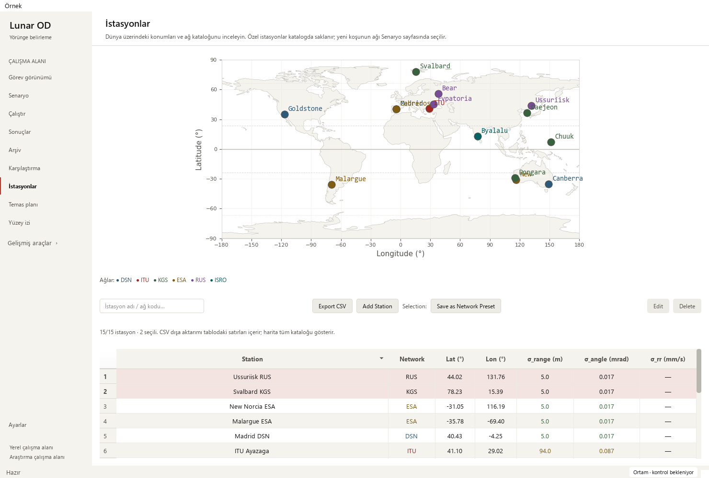

# Station catalogue row identity — 2026-10-16

Base: 1ab65c944d1c83e8511cac233eb18bff067e9cf7. Scope: catalogue row population,
selection/action mapping and display tests in `StationsController`. Scientific
implementation, station source files, noise units and saved-result data are
unchanged.

## Reproduced issue and changes

A descending name sort displayed **Ussuriisk RUS** in selected row zero, but
**Edit** received **Canberra DSN**: handlers indexed the unsorted source list
with the visual row number. Delete protection and network-preset names used the
same incorrect mapping. Map picks also selected an unsorted row number. Filling
a filtered table with sorting enabled could move a name before its coordinate
cells were inserted.

The before/after reproduction ran both the exact committed base controller and
the updated controller with the same isolated settings and catalogue. The
[sanitized receipt](station-sorting-receipt_2026-10-16.json) records the two names.

- Every station-name item carries its filtered source index in Qt.UserRole.
  Edit/delete/preset handlers resolve the visual row through that reference.
- Suspend sorting while populating all seven cells, then restore the existing
  sort. Block partial selection notifications and clear the earlier selection
  when rebuilding a table. A filter change requires a fresh row choice.
- Map picks find the named station in the current visual order after clearing
  the filter. CSV continues to export every filtered source record.

Existing saved presets retain their recorded names. This fix applies to new row
actions and does not infer historical selection intent. It also retains the
current sort comparator; numeric ordering is a separate review.

## Verification

    python -m pytest -p tests.desktop_preferences tests/test_station_catalog_filters.py tests/test_mission_overview.py tests/test_workspace_appearance.py -q
    python tools/run_public_checks.py --junitxml outputs/public-checks.xml
    python -m pytest -p tests.desktop_preferences tests -q -ra --junitxml outputs/full.xml

Targeted: **50 passed**. Four new cases cover name/latitude sorting through DSN,
ESA and cleared filters; exact name/network/coordinate associations; distinct
visible custom/built-in edit and delete targets; actual temporary QSettings
network-preset contents; deletion of only the temporary custom record; and
Madrid map selection after a descending sort. No scientific tolerance changed.

Public gate: **301 passed**, zero failures/errors/skips, in
48.149 seconds. Full local suite: **1,862 passed checks**,
**29 skipped**, zero failures/errors, in 433.143 seconds.
JUnit records 1,891 checks (1,745 named cases and
146 subtest checks). All 13 station cases are in the public gate. Existing
skip policies were retained.

| Local JUnit | SHA-256 |
| --- | --- |
| Targeted | `2D2340C70B2522B34CEF0CAEA6DEE12F1016B1337A438E3783E9F4FEE02F20A1` |
| Public | `BD2374D795B4DEBAF3FCC88E1B535AF84204759D596C588309A8B5A9434F137E` |
| Full | `EE4781F618FB1CE7C5B136D8B1DF23C95014705F6D102240E73E226484BC46C0` |

Native Qt review passed in Modern/display scale 1 and Orchid/scale 2, at
1480×1000, 910×465 and 760×420. Clicking Edit for sorted Ussuriisk passed that
exact station into an intercepted dialog factory returning a cancelled outcome. A two-row preset saved
Ussuriisk/Svalbard in temporary settings. The temporary custom station's delete
confirmation named that station and cancellation retained it. Actual Canberra
map selection, DSN CSV export, all seven columns, key placement and narrow-window
controls remained correct; station-source hashes stayed unchanged. Temporary
records/settings were isolated from the user catalogue.

The existing verified 24-hour solver output reopened with 145 truth states,
four stations and 12 measurement-sample windows. Its observations are synthetic;
all four recorded arc-success flags remain false. Playback/selection and both
small Mission layouts passed. Eight legacy runs retained missing-data guidance
and all 48 source hashes. No new scientific campaign or real telemetry acceptance
was run.

## Interpretation and next work

**Pass with caveats:** software-safe to merge after the gates. Impacted metrics
are displayed/source station identity, coordinate-row associations and preset
names. No numerical baseline drift is expected. Persistence formats and CSV
units remain unchanged. The ignored Graphify graph was refreshed for the new
row-resolution helper. No tooling/dependency configuration was added.

- Review numeric column sorting independently of formatted strings.
- Resolve crowded catalogue station labels while preserving exact selection.
- Review visibility/surface-track help and keyboard use; profile large saved runs
  when representative data is available.
