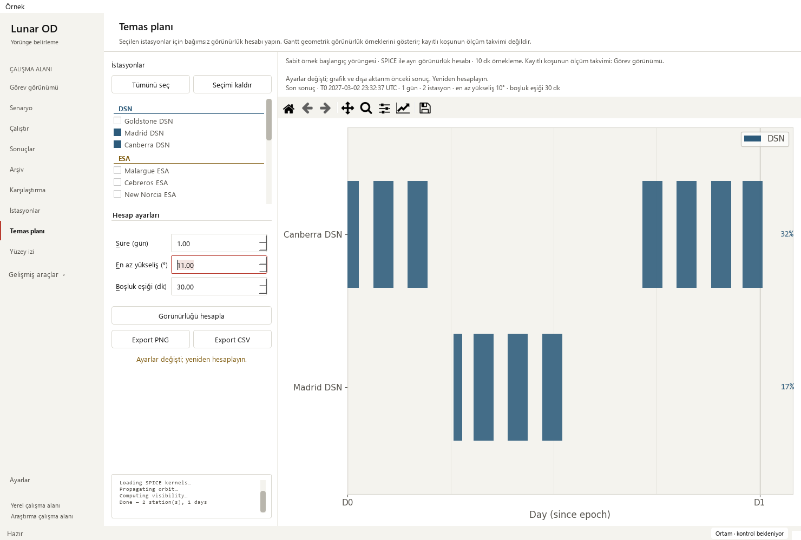

# Visibility result context and consistent exports — 2026-10-16

Base: `3c17a49f662d951b3bb07aa8cf3c97ab4da8b44e` (PR #27).
Changed area: the independent **Temas planı** page's request/result UI state.
Worker equations, propagation, sampling, Gantt renderer, station fixtures,
export serialization and all physics files remain unchanged.

## Reproduced issues

1. Inputs stayed editable during a calculation, and editing after completion
   did not identify the displayed/exported data as a previous request. Elevation
   and gap settings were absent from the result context.
2. On a rerun plotting error, `_last_data` was already replaced while the old
   figure remained. A committed-base controlled reproduction displayed **Madrid
   DSN** in the plot/PNG but exported **Goldstone DSN** in CSV. The updated page
   retains the prior Madrid data/figure pair when rendering the new result fails.

The [sanitized receipt](visibility-context-receipt_2026-10-16.json) records exact
before/after station identities and independent CSV headers. Controlled UI data
and injected failures are distinguished from actual worker execution.

## Design and changes

- Explain the independent SPICE calculation from a fixed example initial state,
  using the existing 600-second geometric-visibility sampling. Mission remains
  the recorded-run measurement timeline.
- Capture submitted station names, duration, elevation and gap threshold in UI
  memory. The caption shows the result epoch, duration/count and actual submitted
  settings; tooltip/accessibility text identifies the fixture and exact stations.
- Lock request controls and suspend duration-settings resync while pending.
  Disable the page's Export PNG/CSV buttons. Keep the prior plot explicitly
  identified. Later edits flag that prior data; restoring values clears the flag.
- Promote data, figure and request context together after plot creation. A failed
  calculation/render restores the known previous pair, or leaves exports disabled
  if no result exists. Failed new payloads are not committed or exported.
- Add unit-bearing Turkish labels, keyboard buddies (Alt+S/E/B), an explicit empty
  selection and a raw-mask explanation for the existing gap parameter.

The snapshot is live UI context, not a new persistent scientific manifest. Export
formats and the original renderer are preserved. No new exact continuous-contact
boundary or radio-availability claim is introduced.

## Test plan and verification

Software risks are stale context, mismatched CSV/PNG, busy/error transitions and
keyboard access. Oracles are captured arguments, exact names/CSV rows, actual
figure labels and source hashes. No tolerance, random seed or baseline changed.

Ten new cases cover locked requests/settings resync, all three parameter edits,
old raw CSV preservation, station replacement, compute failure with/without old
data, plot failure with/without old data, empty selection, scope and keyboard
focus. All failed against the earlier UI. Controlled signals/data test software
state; they do not qualify physics.

    python -m pytest -p tests.desktop_preferences tests/test_visibility_workflow.py tests/test_mission_overview.py tests/test_workspace_appearance.py tests/test_pytest_desktop_app.py -q
    python tools/run_public_checks.py --junitxml outputs/public-checks.xml
    python -m pytest -p tests.desktop_preferences tests -q -ra --junitxml outputs/full.xml

Targeted: **58 passed**. Public: **320 passed**, zero failures/errors/skips,
56.585 seconds. Full: **1,881 passed checks**,
**29 existing skips**, zero failures/errors, 570.872 seconds.
JUnit includes 1,910 checks: 1,764 named cases and
146 subtest checks. The public runner now includes the ten visibility
cases, alongside all 22 station and 35 mission cases.

| Local JUnit | SHA-256 |
| --- | --- |
| Targeted | `d719b37935974e368627a363966c07700d32020c46b6db7ac8982953ca0f0595` |
| Public | `3eb40ba2d1d77565295fa09b147b34903c4107354133856db53024c456a89683` |
| Full | `cd01b99ab6ff919b1a4f6e630fba41c0de0e6fce5b32ac4399db4c7835da41a3` |

Actual Qt offscreen review passed in Modern (scale 1) and Orchid (scale 2), at
1480×1000, 910×465 and 760×420. Each palette ran the unchanged worker once for a
bounded one-day, two-station request: 145 samples at 2027-03-02 23:32:37 UTC.
Inputs were the example initial state and local SPICE kernels, not recorded
spacecraft measurements. Runtime was approximately one second. Raw CSV hashes
matched across palettes and remained identical after keyboard edits and injected
calculation/render failures. Empty/pending/result/edited/failure PNGs were
reviewed. Controls were reachable with existing scrolling; Qt focus-rectangle
scrolling was completed with normal scrollbars to expose full spinbox borders.

Normalized source segments for `_VisWorker`, `_draw_gantt`, `_export_csv` and
`_export_png` match the base exactly; hashes are in the receipt. The fixture hash
is unchanged. The existing saved solver output reopened with 145 truth states,
four stations and 12 measurement-sample windows. Observations remain synthetic;
all four arc-success flags remain false and convergence remains unverified.
Its playback and both small Mission layouts passed. Eight legacy runs retained
missing-data explanations and all 48 source hashes.

`pip check`, repository migration/byte-identity/link checks and diff whitespace
checks passed. Graphify was refreshed for UI call changes. The existing public
runner was extended; no dependency, workflow or tooling configuration was added.
Strict docs/library/release checks must pass on the PR. Local strict docs were
not run because MkDocs is absent from the validated scientific environment.
No long campaign was run.

## Interpretation and next work

**Pass with caveats:** ready for existing PR gates. Impacted metrics are request
identity, retained data, export pairing and UI states. No scientific baseline
drift is expected. Snapshot metadata is not persisted or added to export schemas.
The existing visibility page still requires horizontal scrolling in small windows
(252 px maximum at 910×465; 402 px at 760×420).

- Visibility request/result identity and edit/pending/failure guidance: complete.
- Next: responsive visibility layout to reduce panning; inspect ground-track
  source/model help and stale-result behavior independently.
- Profile larger saved-run workflows when representative source data is available.
