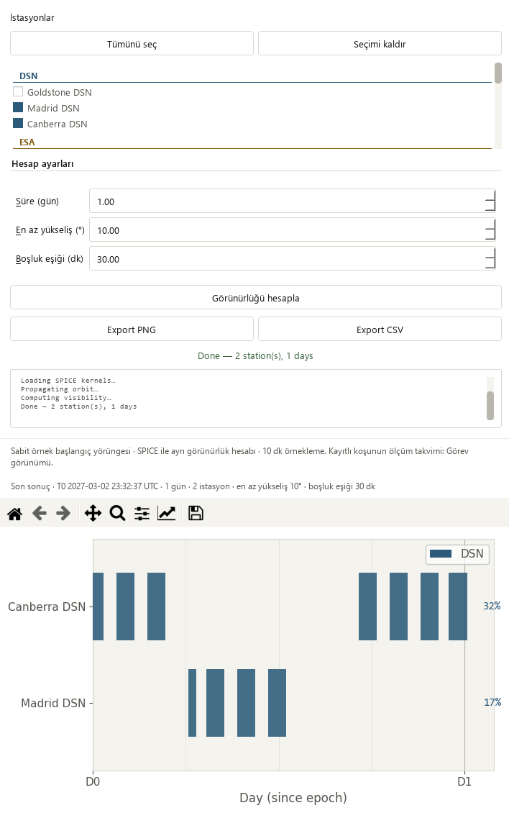

# Responsive visibility workspace — 2026-10-17

Base: `fae760399dc558e044a58b3e46796284eb4b62eb` (PR #28).
Changed area: native Temas planı layout and the visible-page scroll minimum.

## Reproduced issue and design

The previous result-context review measured **252 px** of outer horizontal
scrolling at 910×465 and **402 px** at 760×420. The fixed 960 px workspace floor
and side-by-side control/plot minimums made users pan between settings and data.
Two new integration cases failed against that base, one per window size.

Keep every current function and the Modern/Orchid palettes. Below 900 logical
pixels of page width, place the same settings panel above the same Gantt plot;
use one outer vertical scroll. On a wider page restore the original horizontal
splitter. Station selection remains in its bounded inner list. No new tabs,
collapsed tools or alternative scientific calculation path are introduced.

The 720 px workspace height floor is now part of the visible page's minimum
size hint instead of an explicit fixed minimum overriding taller page hints.
The visibility page reserves the full form/log height and a readable plot region;
its actual minimum is exposed to the stack. This also makes the bottom axis
reachable after stacking. Merely changing orientation or checking that a widget
is `isVisible()` was insufficient: review caught compressed controls and a
scroll range shorter than the new content during implementation. These were
fixed before acceptance; tests now check nonoverlap, actual visible regions,
parent containment and reaching the plot bottom.

The image shows the **complete scroll content**, not a claim that all tools and
the plot fit simultaneously in the small viewport. Normal use scrolls vertically.

## Files and scientific boundary

- `desktop_app/app.py`: allow the visibility workspace to shrink to the existing
  540 px responsive width; preserve the 720 px floor through current-page hints.
- `desktop_app/controllers/visibility_controller.py`: adapt the splitter and
  control/plot minimums on resize, log visibility and result-context updates.
- `desktop_app/ui/pages/visibility_page.ui`: reserve 120 px for station selection
  and 360 px for the canvas holder instead of requiring a fixed plot width.
- `tests/test_visibility_workflow.py`: two native MainWindow regression cases.

No worker equations, inputs, source fixture, station coordinates, physics,
tolerances, sampling, masks, renderer or export serialization changed. Normalized
source segments for `_VisWorker`, `_draw_gantt`, `_export_csv` and `_export_png`
match the base exactly. The existing figure and data objects survive resize;
no new solve is dispatched by layout changes.

## Verification

Oracles: actual outer scrollbar range, widget rectangles and visible regions,
complete plot-bottom reach, identity of the retained data/figure/context,
exact CSV bytes and protected source-segment hashes. No tolerance or baseline
update, new random fixture, dependency or CI configuration is needed.

    python -m pytest -p tests.desktop_preferences tests/test_visibility_workflow.py tests/test_mission_overview.py tests/test_workspace_appearance.py tests/test_pytest_desktop_app.py -q
    python tools/run_public_checks.py --junitxml outputs/public-checks.xml
    python -m pytest -p tests.desktop_preferences tests -q -ra --junitxml outputs/full.xml

Targeted: **60 passed** (13.971 s). Public: **322 passed**
(92.246 s), including all 12 visibility cases. Full:
**1,883 passed checks**, **29 existing skips**, zero failures/errors,
910.885 seconds. JUnit contains 1,912 checks:
1766 named cases plus 146 subtest checks.

| Local JUnit | SHA-256 |
| --- | --- |
| Targeted | `1dc07031658c01160a797f64fdefe4f0325956531aab1e14ab24ddb31917c3cb` |
| Public | `e29e6afa446d8a48a404e70807e31350e4674f906adde3d7d783dd425e44d4e3` |
| Full | `370e39c12e3dbee03be644b547179b0776fc3e45aa5c504462e78a6a1f7954b0` |

Actual Qt offscreen screenshots were inspected in Modern (scale 1) and Orchid
(scale 2), at 1480×1000, 910×465 and 760×420, with successful, edited and retained
failure states. At both small sizes the outer horizontal range is now **0 px**;
parameters, computation, exports and the full lower plot axis are reachable.
The wide layout is restored without changing the data/figure. Existing keyboard
parameter buddies and busy/error identity checks still pass.

The unchanged worker ran bounded one-day requests for Madrid DSN + Canberra DSN:
145 samples, T0 2027-03-02 23:32:37 UTC, 600 s sampling. These are computed
geometric samples from the fixed example initial state and local SPICE kernels,
not recorded spacecraft measurements. Actual worker runtime was about two seconds
per final palette review. CSV bytes match both themes and the prior iteration;
edits and controlled worker/plot failures retain the same matching data/figure.

The existing solver-output workflow reopened 145 truth states, four stations and
12 measurement-sample windows. Playback advanced, station selection worked, both
small Mission layouts had no horizontal overflow, and source hashes stayed intact.
Observations remain synthetic; all four operational-success flags are false and
convergence remains unverified. Eight older runs kept missing-data guidance and
all 48 original source hashes. These checks qualify UI preservation, not solver
accuracy or real telemetry.

The [sanitized receipt](visibility-responsive-receipt_2026-10-17.json) records
counts, hashes and native review results. Repository/link checks, dependency
consistency and whitespace checks passed. The local graph was refreshed for new
UI calls. Hosted public, documentation, library, dependency and release gates
must pass on the PR; local strict docs are not run because MkDocs is absent from
the validated scientific environment. No long scientific campaign was run.

## Interpretation and work list

**Pass with caveats:** the reproduced horizontal panning is eliminated at the two
tested small sizes, with full form/plot reach and original functions preserved.
Vertical scrolling and the station list's own scrolling remain intentional; other
legacy scientific forms retain their existing horizontal width floor.

- Visibility request/result identity and export consistency: complete in PR #28.
- Responsive visibility layout and complete lower-axis reach: complete here.
- Next: inspect ground-track source/model explanations and stale-result behavior.
- Profile larger recorded-run workflows when representative data is available.
