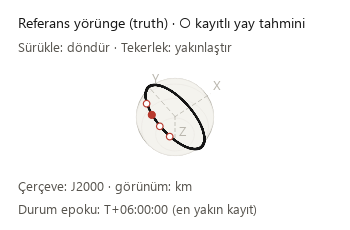
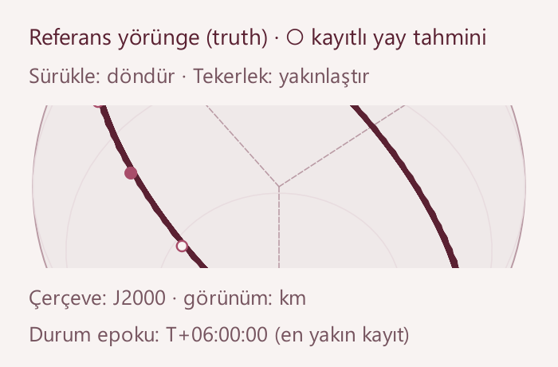

# Orbit label readability — 2026-10-12

Base: 85a3c5a49bb005a4d206020324d69c5fe50fc2ea. This iteration changes the
shared native orbit renderer used by Mission and Results.

## Observed problem and fix

At the smallest window size, the orbit legend and drag/zoom instructions were
drawn on the same baseline and overlapped. Enlarged orbit geometry could also
paint into the labels because there was no dedicated plot viewport.

- The legend and instructions now have separate text bands that wrap using
  actual Qt font metrics. Frame and kilometre units remain above the saved-state
  epoch; the nearest-record explanation remains visible.
- The orbit, coordinate axes, saved estimates and current-state marker are
  clipped to the intervening viewport. Zooming preserves the labels.
- The cursor band reserves space for the longest saved timestamp, including
  the nearest-record suffix. Playback updates do not move or rebuild the plot.
- The drawing scale now fits that viewport. At the minimum 350×230 plot size,
  the complete orbit is smaller; zoom remains available without covering text.

## Verification

    python -m pytest -p tests.desktop_preferences tests/test_mission_overview.py tests/test_tracking_render_semantics.py tests/test_large_workspace.py -q

**40 checks passed.** Two added raster regressions exercise 350×230 and 780×440
plots: text rectangles do not overlap, measured text fits, and zoomed geometry
does not change pixels in the annotation bands. Existing checks still select
the exact raw state in a 12,001-sample record and reuse the playback base cache.

The isolated public gate passed **267 cases** with zero failures, errors or
skips in 27.811 seconds. The full local regression passed **1,795 checks**, with
29 existing skips and zero failures/errors, in 250.552 seconds. JUnit records
1,824 checks: 1,678 named cases and 146 subtest checks. Optional slow/data-dependent
skips were retained.

    python tools/run_public_checks.py --junitxml outputs/public-checks.xml
    python -m pytest -p tests.desktop_preferences tests -q -ra --junitxml outputs/full.xml

Local JUnit receipt SHA-256 hashes:

| Receipt | SHA-256 |
| --- | --- |
| Public | `2CD2131A7D7B8DD1F172F5A9F7A3AEE1733F4A397BC371BAFC27D397690A65F5` |
| Full | `CA0C1694624AF378034F0232E760892DC0C1ED3EAF35AFA4851B91A0AB009C2E` |

Native Qt review covered initial/loaded 1480×1000 views and loaded 910×465 /
760×420 windows; controls remained reachable without horizontal scrolling.
Separate plots were inspected at 350×230, 500×260 and 780×440, including four-times
zoom, Modern at display scale 1 and Orchid at display scale 2.

The existing verified 24-hour solver output still shows 145 saved truth states,
four stations and 12 measurement-sample windows. Its observations are synthetic;
all four recorded arc-success flags remain false. Selection, playback and drawing
preserved its source hashes. Eight legacy runs reopened and all 48 verified
source-file hashes remained unchanged. See the [receipt](orbit-labels-receipt_2026-10-12.json).

Scientific calculations, numerical tolerances, source validation, frames and
recorded times are unchanged. Raster checks validate presentation, not estimator
convergence. No new scientific campaign was run.

## Remaining design work

- Check dense station-label placement and map proportions across viewports.
- Review specialist pages for clear units, short help and keyboard access.
- Profile workflows with representative large saved runs when available.
