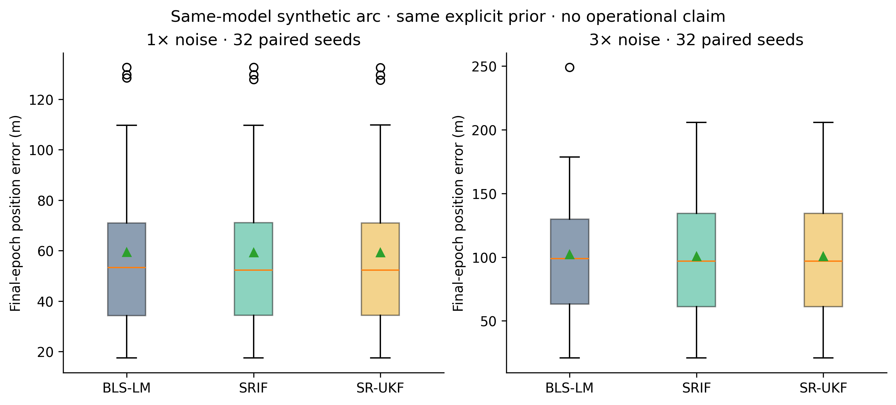
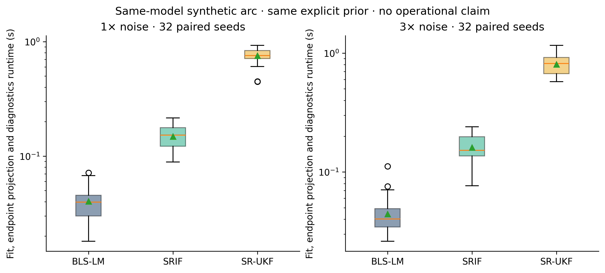

# Paired BLS-LM / SRIF / SR-UKF comparison

This bounded Level-0 experiment uses **32 paired seeds per noise block**, 64 seeded arcs and 192 estimator fits. The two noise blocks share seeds; they are not 64 independent geometries. [Predeclared design](paired-benchmark-plan.md).

Producing commit: `732fda80114fe7e073e641314215b19704a92d1f`; clean source: `True`. Campaign elapsed time: 63.87 s on the recorded environment.



| Noise | Estimator | Median / p95 position (m) | Median velocity (m/s) | Numerical criteria | Solver termination | Mean NEES |
|---|---|---|---|---|---|---|
| 1× | BLS-LM | 53.255 / 129.053 | 0.06488 | 32/32 | 100.0% | 5.005 |
| 1× | SRIF | 52.280 / 128.687 | 0.06306 | 32/32 | 25.0% | 4.992 |
| 1× | SR-UKF | 52.247 / 128.486 | 0.06304 | 32/32 | 100.0% | 4.989 |
| 3× | BLS-LM | 98.997 / 176.211 | 0.13241 | 32/32 | 100.0% | 5.306 |
| 3× | SRIF | 96.922 / 176.041 | 0.13206 | 32/32 | 43.8% | 5.175 |
| 3× | SR-UKF | 96.931 / 176.025 | 0.13203 | 32/32 | 100.0% | 5.175 |

## Interpretation and scientific review

**Accept with caveats** for this declared synthetic comparison. All three estimators meet the predeclared numerical error/covariance criteria in all attempted trials. Solver termination is a separate criterion: SRIF reaches MaxIter in many trials even when its state error is small. Those trials are retained and are not called converged. See raw stop reasons below.

Final errors are close in this fixed, well-behaved geometry; the data do not establish general estimator superiority. BLS-LM/SRIF estimate an initial state using the complete arc; the UKF filters sequentially. Only their aligned final epoch is compared. Priors, R, zero Q and sigma-point settings are explicit in the design and inputs.

Final NEES has 6 degrees of freedom. For N=32 independent trials **within one block**, the predeclared 95% mean-NEES interval is [4.860, 7.258]. This is a diagnostic under the matched Gaussian prior and same-model assumptions, not a blanket calibration certificate. NIS is recorded for UKF innovations; batch post-fit residuals are stored separately. No independent-sample chi-square claim is made over the 124 correlated within-arc updates. Per-channel means, RMS and acquisition-order lag-1 correlations are in trials.json; no formal whiteness or station-geometry robustness claim is established.



Runtime includes fit, endpoint propagation and diagnostics; batch and sequential paths perform different work. Measurements are serial wall-clock values from the saved environment, without warm-up or hardware normalization. They do not establish portable speed ratios.

## Reproduction and evidence

```text
python examples/benchmark_estimators.py --output outputs/benchmark
```

- [Summary, exact configuration, source/environment identities and all distributions](../figures/benchmark/summary.json)
- [Per-trial metrics, solver stops and failure fields](../figures/benchmark/trials.csv)
- [Residual/innovation channel diagnostics](../figures/benchmark/trials.json)
- [Raw paired observations, truth, initial states, priors, final covariances and UKF histories](../figures/benchmark/raw-trials.zip)
- [Published artifact identities](../figures/benchmark/published.json)

The summary hashes each original NPZ member inside raw-trials.zip; published.json additionally hashes the archive and curated figures. No errors, exceptions, stopped solves or outliers are silently excluded. This same-model, idealized visibility experiment does not qualify SPICE, real station availability, model mismatch or flight performance.
