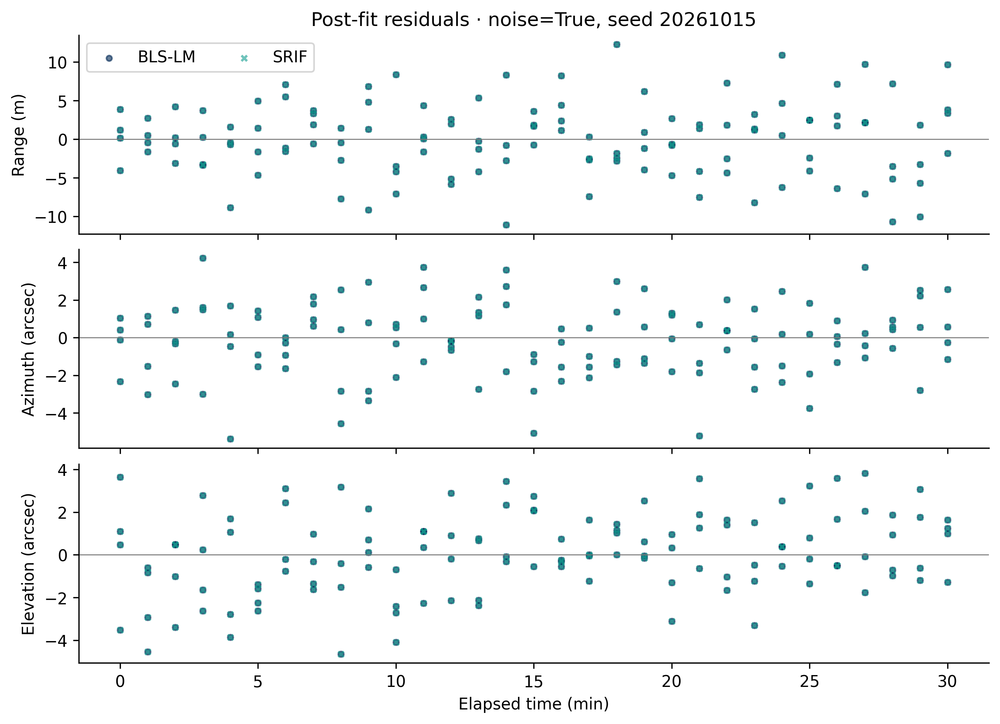
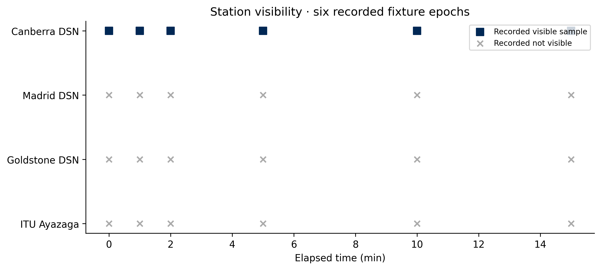

# Results gallery

Small examples with an explicit source trail. The first two figures share one
synthetic OD run; the third is a separate recorded visibility fixture.

## Paired batch fit


BLS-LM and SRIF fit the same 124 observation rows over 30 minutes, with the same
initial guess and noise seed `20261015`. Dotted grey is the propagated initial
guess; solid navy and dashed teal are the fitted trajectories. The near-overlap
is visible agreement for this case, not a statistically supported ranking.

| Quantity | BLS-LM | SRIF |
|---|---:|---:|
| Initial-epoch fitted position error | about 43.17 m | about 43.17 m |
| Arc-end fitted position error | about 49.56 m | about 49.56 m |
| Range residual RMS | about 4.67 m | about 4.67 m |

One independent arc, one independent seed, Level 0 truth. Runtime, iteration count,
rank, native condition diagnostics and exact digits are recorded in the
[reference summary](../figures/quickstart/summary.json). Native condition numbers
refer to different internal matrices and must not be ranked against each other.

## Measurement fit



Observed-minus-computed residuals for the same paired fit. The CSV records angles
in radians; the figure converts them to arcseconds. These are post-fit residuals,
not sequential innovations; NIS/NEES confidence bands are therefore not attached.
The visible scatter alone does not establish whiteness or covariance consistency.

## Recorded station visibility



Six recorded epochs from the committed MATLAB/SPICE snapshot fixture. Squares
show recorded visible samples and crosses show recorded not-visible samples.
No continuous pass duration is inferred between the sparse epochs. This is a
different dataset from the idealized quickstart; it does not certify that arc's
station schedule. [Fixture identity and exact data keys](../figures/quickstart/visibility-source.json).

## Reproduce and audit

```powershell
python examples/quickstart_od.py --output outputs/quickstart
# Maintainer step: run only from a clean, committed checkout.
python tools/build_showcase.py --run outputs/quickstart
```

The second command explicitly replaces these curated documentation artifacts;
it verifies the run's hashes and records its source revision. It never regenerates
historical Phase 17 results. Review new numbers before committing them.

Source chain: [driver](../../examples/quickstart_od.py) →
[configuration](../../examples/configs/quickstart.json) →
[observations](../figures/quickstart/observations.csv),
[states](../figures/quickstart/states.csv),
[residuals](../figures/quickstart/residuals.csv) → figures and summary.
The visibility figure comes from [the recorded fixture](../../fixtures/spice_snapshots.json)
through [the gallery builder](../../tools/build_showcase.py).

Science review: **Accept with caveats** as an onboarding example. Robustness or
estimator superiority needs Monte Carlo support; real-world accuracy needs
independent validation. Current research conclusions remain in the
[authoritative study status](../../studies/phase17/reports/phase17_authoritative_status.md).
