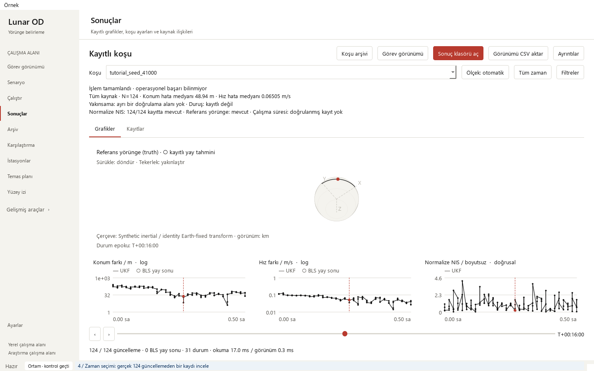

# Desktop walkthrough and data-free tutorial

The Windows portable download includes its own CPython runtime and dependencies.
Extract the **whole** ZIP into a writable directory, then double-click
`LunarOD.cmd`. A separate Python installation or pip command is not required.
Keep the `app` and `runtime` folders beside the launcher.

Get the named `windows-x64-portable.zip` asset from
[GitHub Releases](https://github.com/halici21/lunar-orbit-determination/releases).
The wheel is the scientific library; the source ZIP uses the documented setup
commands. The portable build is an unsigned alpha ZIP, not an installer.

## First calculation without external data

1. Open **Örnek → Verisiz sentetik eğitimi başlat**.
2. Follow the real calculation in **Çalıştır**; it runs in a cancellable child process.
3. **Sonuçlar** opens after the completion record is written. Inspect position
   and velocity differences, normalized NIS, individual records and source details.
4. To compare the two generated runs, open **Karşılaştırma** and select
   `tutorial_seed_41000_ukf_updates.csv` and `tutorial_seed_41001_ukf_updates.csv`
   from that run's output directory. The measurement/initial-error seed differs;
   this is a descriptive comparison of two realizations, not an estimator ranking.

Results live under `app/results/tutorial/` in a portable download, or
`results/tutorial/` in a source checkout. The monitor and result source inspector
show the exact directory. Preserve that directory before replacing an application
version. Cancelling a tutorial does not publish a successful completion record.

The tutorial computes real square-root UKF updates for two seeded synthetic
arcs. Each contains 124 range/azimuth/elevation observations and 31 truth states.
Its force model is lunar point mass, its stations and identity frame transform
are synthetic, and it retains all scheduled observations. Explicit prior, zero
process noise, seeds and input/output identities are saved with the artifacts.
It is a Level-0 educational example. The environment page may correctly report
missing kernels while this independent tutorial remains runnable.

## Recorded workflow

[Watch the complete 60-second desktop recording](../media/desktop/desktop-walkthrough.mp4).



| Time | Recorded action |
|---|---|
| 0–5 s | Open the actual application and tutorial menu |
| 5–12 s | Launch the real scientific QProcess and monitor execution |
| 12–26 s | Inspect real results and select an update epoch |
| 26–35 s | Open run details and source identities |
| 35–54 s | Load two stored runs; inspect comparison and configuration differences |
| 54–60 s | Return to the recorded result |

The video captures actual Qt widget rendering using the offscreen platform.
Its footer supplies recording captions; no solver values or application screens
are fabricated. [Capture source and result identities](../media/desktop/recording.json).
The recording tool is [record_desktop_walkthrough.py](../../tools/record_desktop_walkthrough.py):

```text
python -m pip install -r requirements/windows.txt -r requirements/release.txt
python -m pip install -e .
python tools/record_desktop_walkthrough.py --output outputs/desktop-recording
```

## SPICE-backed scientific scenarios

For ordinary scenarios, choose and verify your own kernel directory in
**Ayarlar**. The portable download does not redistribute SPICE kernels, large
gravity fields or historical private campaign inputs. Follow the
[Windows data setup](../windows-quickstart.md) and
[support matrix](../validation/support-matrix.md).

`Verify.cmd` independently checks the bundled files/imports, real QProcess
execution, cancellation, tutorial calculation and desktop shutdown. It records
results under the portable application's `qualification/` directory.
`LunarOD.cmd --check` runs the same checks without a final pause. Generated
interpreter caches are runtime state; immutable files are checked before and
after normal application execution.
