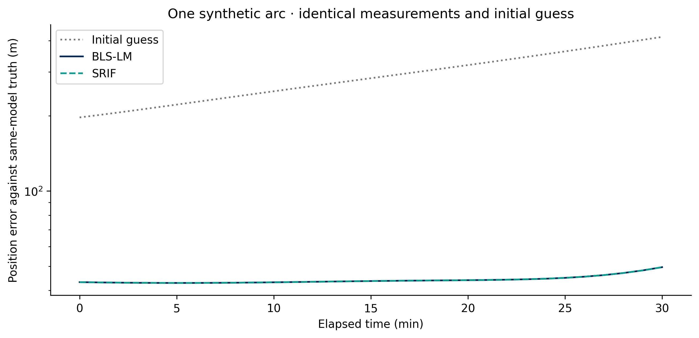

# Your first orbit determination fit

Fit a perturbed lunar initial state to seeded range, azimuth and elevation
measurements. This example needs no SPICE kernels, gravity downloads or desktop.

## Install from a checkout

```powershell
git clone https://github.com/halici21/lunar-orbit-determination.git
cd lunar-orbit-determination
py -3.13 -m venv .venv
.\.venv\Scripts\python.exe -m pip install -e .
.\.venv\Scripts\python.exe examples/quickstart_od.py
```

For the qualified Windows desktop environment, use `setup_windows.cmd` instead
of the library-only install above. Python 3.13.2 / Windows x64 is the reference
environment. First execution can include optional numerical JIT compilation;
reported solver timings exclude imports and figure generation.

## What happens

1. Propagate a six-component lunar state for 1,800 seconds with lunar point-mass gravity.
2. Schedule four synthetic stations every 60 seconds: 124 range/azimuth/elevation observation rows.
3. Add Gaussian noise with seed `20261015`: 5 m range and 10 microradians per angle.
4. Perturb the initial state by `[150, -100, 80]` m and `[0.05, -0.04, 0.03]` m/s.
5. Fit the same data and initial guess with the existing BLS-LM and SRIF implementations.
6. Save the states, observations, residuals, figures, configuration and source hashes.

The measured starting position error is approximately **197.23 m**. The reference
run gives an arc-end position error of approximately **49.56 m** for each method.
These are different epochs; the position-error plot also includes the uncorrected
initial-guess trajectory at every epoch. Inspect the full curves rather than
subtracting those two numbers as if they were the same-epoch improvement.



The reference summary, environment, stop reasons and exact producing commit are
in [summary.json](../figures/quickstart/summary.json). Small numerical differences
are expected across environments; runtimes and image bytes are not fixed baselines.

## Inspect the output

Default output: ignored `outputs/quickstart/`.

| File | Contents |
|---|---|
| `summary.json` | Config, seed, source identity, environment, per-estimator metrics, artifact hashes |
| `observations.csv` | Receive times, synthetic measurements, station and epoch indices |
| `states.csv` | Initial-guess and fitted trajectories alongside truth, in m and m/s |
| `residuals.csv` | Observed-minus-computed range (m), azimuth and elevation (rad) |
| `position-error.png` / `.svg` | Same-model position-error histories |
| `residuals.png` / `.svg` | Post-fit residuals; angles displayed in arcseconds |
| `fit-preview.gif` | A time reveal of the recorded error curves, not solver iterations |

The configuration is [quickstart.json](../../examples/configs/quickstart.json).
To experiment, copy it outside the tracked tree and change the seed or initial
error, then run:

```powershell
python examples/quickstart_od.py --config my-config.json --output outputs/my-fit
```

`noise_enabled: false` provides a same-model recovery check. Measurement weighting
still uses the configured positive sigmas. The public tests check recovery against
the known injected truth and reproducible noise generation.

## Interpretation and limits

This is **Level 0 same-model truth**, one arc and one seed. Earth is held at a fixed
offset, the frame transformation is identity, and every scheduled station sample
is retained. Elevation masks, lunar occultation, Earth rotation, light time,
aberration, higher-degree gravity and force-model mismatch are absent. The
stations are synthetic, not a qualified DSN network.

Both batch methods receive identical observations, sigmas, initial state, force
model, integration tolerances and iteration budget; no explicit state prior is
supplied. Their internal damping/QR algorithms and condition diagnostics differ.
SR-UKF is intentionally outside this small paired batch fit: its sequential
covariance/process-noise assumptions require a separately specified comparison.

The residual plots are descriptive. One run does not establish residual whiteness,
covariance calibration, Monte Carlo robustness or operational navigation accuracy.
Review the [support matrix](../validation/support-matrix.md) and
[research studies](../site/studies.md) before designing a scientific campaign.
